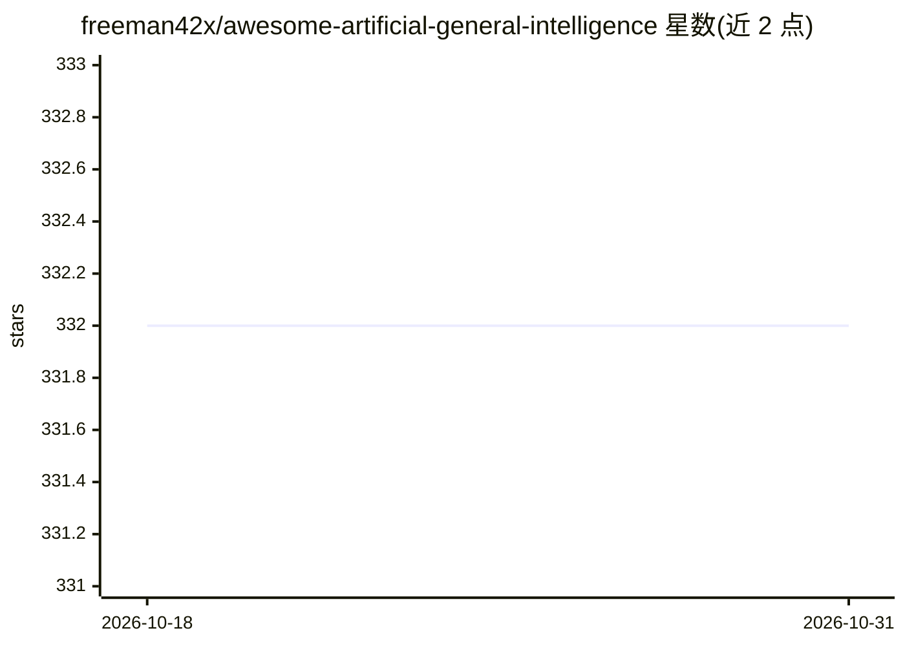

# freeman42x/awesome-artificial-general-intelligence

⭐ 332 · NOASSERTION · 推送 2026-05-11 · [GitHub](https://github.com/freeman42x/awesome-artificial-general-intelligence) · 个人维护

**AGI（通用人工智能）主题的资源导航清单**

一个 awesome 类策展清单，收录与通用人工智能（AGI/强 AI）相关的学习与研究资源，按类别组织：入门介绍、文章、书籍、科学论文、播客、课程、视频、组织/项目（OpenAI、DeepMind、OpenCog 等）、论坛社区、竞赛、会议、影视动漫及教育规划。条目以链接列表形式呈现，不提供软件安装或运行方式，仓库以 CC0 许可发布并接受贡献。

## 筛选速览

| 维度 | 判定 | 备注 |
|---|---|---|
| AI 角色 | `ai-knowledge` | 知识聚合/清单类 |
| 许可风险 | `none` | NOASSERTION |
| 部署形态 | `None` |  |
| 模型依赖 | — | README 未给出锁定关系 |
| 硬件要求 | — | 无带数字的原话,不猜 |
| 安装摩擦 | `low` | 无编译、无系统依赖或容器化 |
| 成熟度 | — | 结构信号不足 |

## 能力要点

- 覆盖书籍、论文、课程、组织、论坛等多类 AGI 资源
- 收录 OpenCog、Open-NARS、Numenta 等 AGI 相关开源项目条目
- 含 AGI 研究者教育规划与课程资源

## 适用场景

- 系统查找 AGI 相关的书籍、论文与课程
- 了解 AGI 领域的研究组织与社区
- 为进入 AGI 研究方向制定学习路线

## 场景标签

`精选清单` · 领域:学习与行业

## 证据(README 行号)

> L1: # Awesome Artificial General Intelligence
> L7: ## General Introductions

## 星数曲线

2026-10-18 332 → 2026-10-31 332（+0）

---
*卡片 v1 · prompt 1.4 · 生成 2026-10-21 · 置信度 high · 依据 README sha `f3aa0177684b` · [字段定义](../../DATASET.md)*
