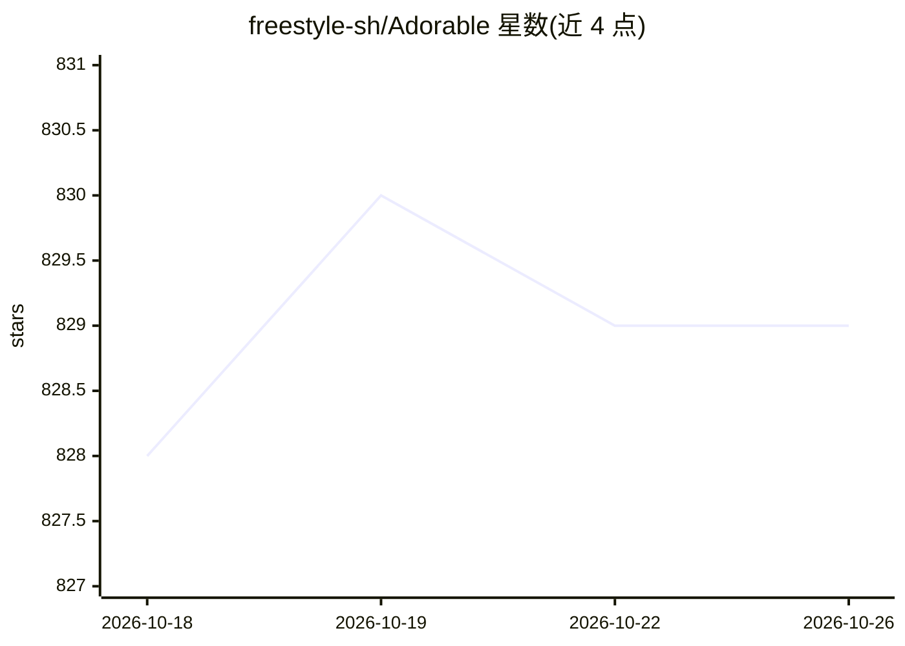

# freestyle-sh/Adorable

⭐ 829 · TypeScript · MIT · 推送 2026-08-25 · [GitHub](https://github.com/freestyle-sh/Adorable) · 组织维护

**开源 AI 应用构建器：对话生成应用并实时预览、发布**

对话式 AI 应用构建平台：用户描述需求，AI agent 在真实 Linux VM（Freestyle VM）中编写、编辑并运行代码，提供热重载实时预览、可开多个终端会话、一键发布到生产 VM 并支持快照回滚。每个项目由 dev VM 与 production VM 组成，项目状态与会话历史持久保存在 VM 上，无数据库（JSON 文件存储）。技术栈为 Next.js + Vercel AI SDK（支持 OpenAI 与 Anthropic 模型），通过 npm 安装自托管运行。

## 筛选速览

| 维度 | 判定 | 备注 |
|---|---|---|
| AI 角色 | `ai-native` | 本体是模型或模型工具 |
| 许可风险 | `permissive` | MIT |
| 部署形态 | `library` | 以包/库形式分发 |
| 模型依赖 | — | README 未给出锁定关系 |
| 硬件要求 | — | 无带数字的原话,不猜 |
| 安装摩擦 | `low` | 无编译、无系统依赖或容器化 |
| 成熟度 | — | 结构信号不足 |

## 能力要点

- AI agent 在 Linux VM 中编写、编辑并运行代码，实时预览
- 发布到生产 VM 约 4s，快照支持任意历史版本回滚
- 项目状态与会话历史持久存储在 VM 上，无数据库
- 支持从任意公开 GitHub 仓库导入创建项目

## 适用场景

- 用自然语言描述并快速生成可预览的 Web 应用
- 自托管一个类 Lovable 的 AI 应用构建平台
- 从 GitHub 仓库导入代码继续 AI 辅助开发

## 场景标签

`代码生成` `编码 Agent` · 领域:编码与开发

## 证据(README 行号)

> L5: An open-source AI app builder. Describe what you want, and Adorable builds it for you in real time — complete with a
> L11: - **Conversational app building** — Chat with an AI that writes, edits, and runs code inside a real Linux VM
> L20: - **AI:** Vercel AI SDK with OpenAI and Anthropic support

## 星数曲线

2026-10-18 828 → 2026-10-26 829（+1）

---
*卡片 v1 · prompt 1.4 · 生成 2026-10-21 · 置信度 high · 依据 README sha `cbbebadb8efe` · [字段定义](../../DATASET.md)*
