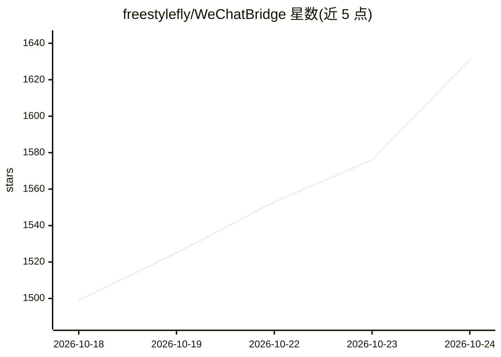

# freestylefly/WeChatBridge

⭐ 1,631 · Swift · MIT · 推送 2026-10-16 · [GitHub](https://github.com/freestylefly/WeChatBridge) · [官网](https://render.qmuse.pub/p/muse/2413870555736078/index.html) · 个人维护 · 中文 README

**把微信聊天记录一键转发到 AI Agent 与 Obsidian 的 macOS 工具**

原生 macOS Share Extension 工具：利用微信 4.1.13+ 的合并转发功能，把包含 TXT、图片和视频的 ZIP 归档转发到 Codex、Claude、豆包、千问办公、DeepSeek Harness 等 AI Agent 桌面应用（激活目标 App 并自动粘贴），或沉淀为 Obsidian Markdown 笔记并保留原始附件。支持分批收集、场景提示词、SKILL.md 技能管理与自定义转发目标。隐私边界明确：不读取微信数据库，Share Extension 无网络权限。要求 macOS 14+，安装包经蓝奏云发布。

## 筛选速览

| 维度 | 判定 | 备注 |
|---|---|---|
| AI 角色 | `ai-enhanced` | 去掉 AI 部分产品仍成立 |
| 许可风险 | `permissive` | MIT |
| 部署形态 | `None` |  |
| 模型依赖 | — | README 未给出锁定关系 |
| 硬件要求 | — | 无带数字的原话,不猜 |
| 安装摩擦 | `low` | 无编译、无系统依赖或容器化 |
| 成熟度 | — | 结构信号不足 |

## 能力要点

- 十二个原生转发入口，直接出现在微信转发菜单
- 转发时激活目标 AI Agent 应用并自动粘贴聊天归档
- 沉淀到 Obsidian：生成 Markdown 笔记并按聊天名组织、保留原始 ZIP
- 分批收集超过 100 条聊天记录，收齐后一次发送

## 适用场景

- 把群聊讨论记录交给 AI Agent 处理或总结
- 将微信聊天记录归档进 Obsidian 本地知识库
- 为不同群聊配置场景提示词后批量转发

## 场景标签

`知识库管理` · 领域:知识与检索

## 证据(README 行号)

> L3:  从微信转发菜单，把聊天记录送进 AI Agent 与本地知识库。
> L22: 系统的“转发到其他应用”列表只展示带有 Share Extension 的 App。微信流补齐这层入口，让一次转发直接抵达 Codex、Claude、豆包、千问办公、WorkBuddy、WeSight、DeepSeek Harne
> L48: |发给 Codex|激活 ChatGPT/Codex 并粘贴聊天归档|

## 星数曲线

2026-10-18 1,499 → 2026-10-24 1,631（+132）

---
*卡片 v1 · prompt 1.4 · 生成 2026-10-21 · 置信度 high · 依据 README sha `bf3257de82d3` · [字段定义](../../DATASET.md)*
