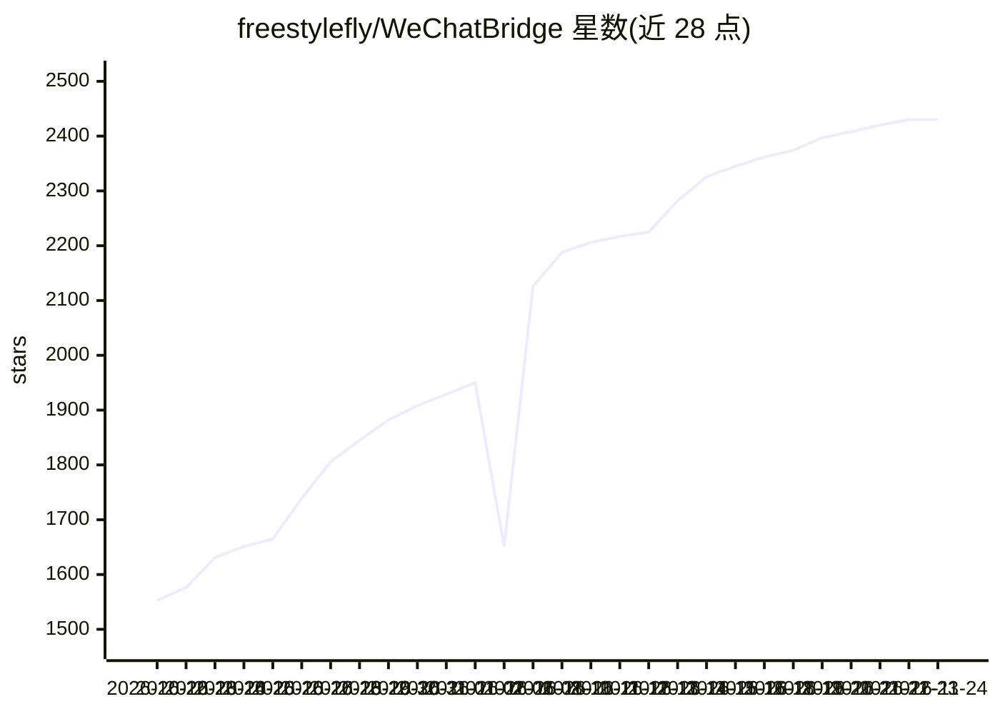

# freestylefly/WeChatBridge

⭐ 2,430 · Swift · MIT · 推送 2026-11-22 · [GitHub](https://github.com/freestylefly/WeChatBridge) · [官网](https://render.qmuse.pub/p/muse/2413870555736078/index.html) · 组织维护 · 中文 README

**macOS 微信用户把聊天记录一键转发给 AI Agent 与 Obsidian 的工具**

基于 macOS 微信 4.1.13「合并转发到其他应用」机制的原生工具：注册十二个 Share Extension 入口，把微信导出的聊天归档 ZIP 附上场景提示词后转发给 Codex、Claude、豆包、千问办公等 Agent 应用，或生成 Markdown 笔记存入 Obsidian/文件夹；支持单群场景提示词、SKILL.md 技能包、超 100 条消息的分批收集、批次记录与失败兜底。不读数据库、不注入微信，Share Extension 在沙盒中运行且无网络权限。提供蓝奏云安装包，源码可用 SwiftPM 构建。

## 筛选速览

| 维度 | 判定 | 备注 |
|---|---|---|
| AI 角色 | `ai-native` | 本体是模型或模型工具 |
| 许可风险 | `permissive` | MIT |
| 部署形态 | `None` |  |
| 模型依赖 | locked-api |  |
| 硬件要求 | — | 无带数字的原话,不猜 |
| 安装摩擦 | `low` | 无编译、无系统依赖或容器化 |
| 成熟度 | `idea` | |

## 能力要点

- 十二个原生 Share Extension 入口，转发菜单中直接选择目标
- 按群聊保存场景提示词并管理 SKILL.md 技能包
- 分批收集超 100 条消息后一次发送
- 本地化隐私设计：不读微信数据库，Share Extension 沙盒无网络权限

## 适用场景

- 把群聊几百条消息一键交给 AI 生成总结和待办
- 把微信聊天记录和附件按聊天名归档进 Obsidian
- 为不同微信群配置各自的转发提示词场景

## 场景标签

`知识库管理` `AI 助手` · 领域:对话与助手

## 证据(README 行号)

> L31:  转发到 Codex、Claude、豆包、千问办公、WorkBuddy 等，自动带上提示词并粘贴好聊天记录，回车就出总结、待办和纪要。
> L4:  在微信「转发到其他应用」里直接选 Codex、Claude、豆包、千问、Obsidian……不读数据库、不注入微信，全程本地。

## 星数曲线

2026-10-22 1,553 → 2026-11-24 2,430（+877）

---
*卡片 v1 · prompt 1.4 · 生成 2026-11-23 · 置信度 mid · 依据 README sha `38330524e98e` · [字段定义](../../DATASET.md)*
