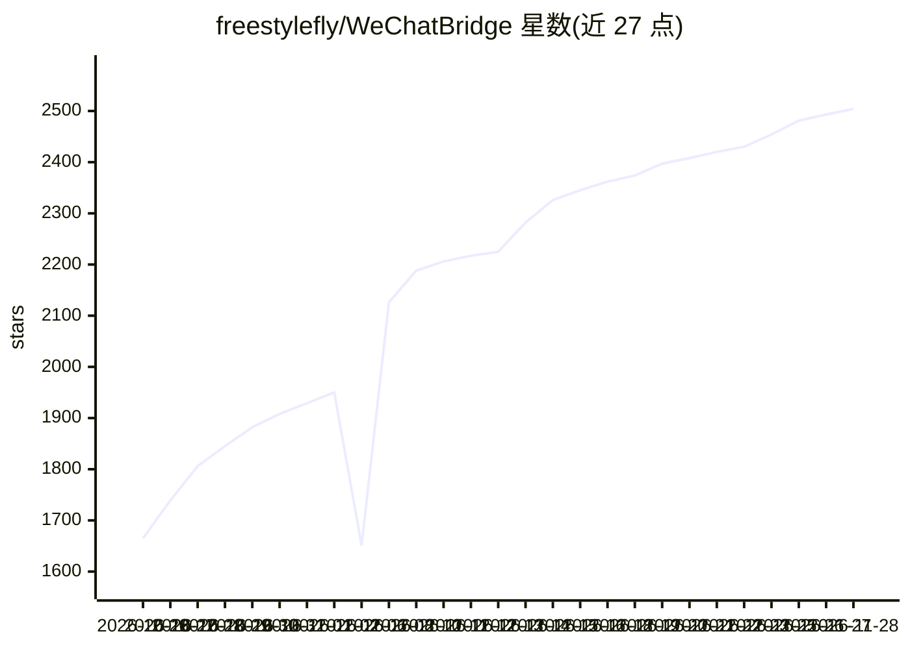

# freestylefly/WeChatBridge

⭐ 2,504 · Swift · MIT · 推送 2026-11-24 · [GitHub](https://github.com/freestylefly/WeChatBridge) · [官网](https://render.qmuse.pub/p/muse/2413870555736078/index.html) · 组织维护 · 中文 README

**把微信聊天记录转发给 AI Agent 与 Obsidian 的 macOS 工具**

利用 macOS 微信 4.1.13 起的「合并转发到其他应用」能力，通过 Share Extension 补上第三方应用入口：微信多选消息合并转发后，工具自动激活目标应用、附加场景提示词并粘贴聊天 ZIP 归档，交由 Agent 生成总结、待办与纪要，或一键存为 Obsidian/文件夹中的 Markdown 笔记并保留原始图片附件。支持分批收集超过 100 条消息、按群配置场景提示词与 SKILL.md 技能包。不读取微信数据库、不注入进程，Share Extension 在沙盒中运行且无网络权限。提供 macOS/Windows 安装包，iOS 版开发中。

## 筛选速览

| 维度 | 判定 | 备注 |
|---|---|---|
| AI 角色 | `ai-enhanced` | 去掉 AI 部分产品仍成立 |
| 许可风险 | `permissive` | MIT |
| 部署形态 | `None` |  |
| 模型依赖 | — | README 未给出锁定关系 |
| 硬件要求 | — | 无带数字的原话,不猜 |
| 安装摩擦 | `low` | 无编译、无系统依赖或容器化 |
| 成熟度 | `idea` | |

## 能力要点

- 十二个内置转发入口，覆盖 Codex、Claude、豆包、千问办公等 Agent 与 Obsidian
- 分批收集机制突破微信单次 100 条转发上限
- 按群聊保存场景提示词并管理 SKILL.md 技能包
- 本地化隐私设计：不读数据库、沙盒内运行、无网络权限

## 适用场景

- 把几百条群聊记录一键交给 AI 生成总结和待办
- 将群里的聊天记录与附件沉淀为 Obsidian 知识库笔记
- 为不同的群配置不同场景提示词，转发时按需选择
- 把微信转发入口接到自己维护的任意 macOS 应用

## 场景标签

 · 领域:消息转发/AI 助手工具

## 证据(README 行号)

> L4:  在微信「转发到其他应用」里直接选 Codex、Claude、豆包、千问、Obsidian……不读数据库、不注入微信，全程本地。
> L86: macOS 微信 4.1.13 起，多选聊天记录后可以「合并转发」给第三方应用：微信会生成一份包含 TXT、图片和视频的 ZIP，正好适合交给 AI Agent 处理，或沉淀进本地知识库。
> L88: 但系统的「转发到其他应用」列表只显示带有 Share Extension 的应用，大多数 AI 工具并不在里面。微信流补上了这层入口，让一次转发直接到达你常用的 Agent、Obsidian、剪贴板或你指定的任何应用。

## 星数曲线

2026-10-26 1,665 → 2026-11-28 2,504（+839）

---
*卡片 v1 · prompt 1.4 · 生成 2026-11-24 · 置信度 high · 依据 README sha `0d1caffefec5` · [字段定义](../../DATASET.md)*
