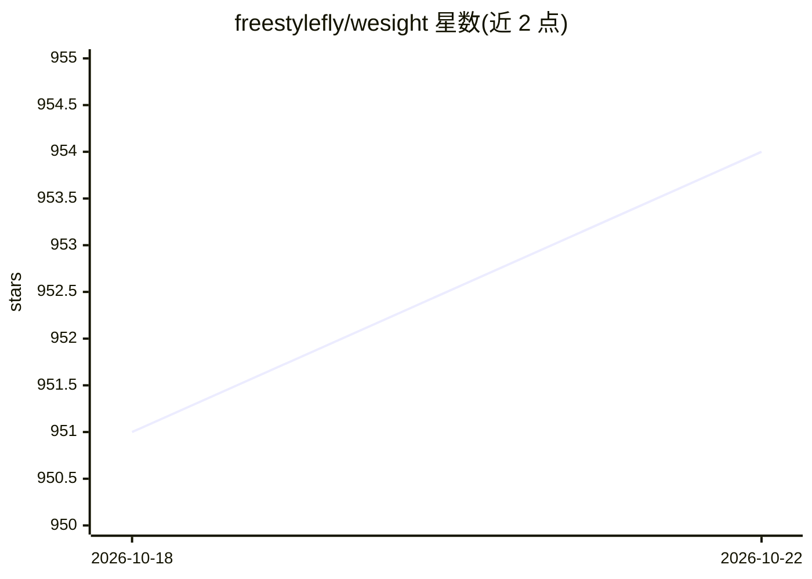

# freestylefly/wesight

⭐ 955 · TypeScript · MIT · 推送 2026-10-01 · [GitHub](https://github.com/freestylefly/wesight) · [官网](https://wesight.ai) · 个人维护 · 中文 README

**桌面 AI agent 工作台：统一安装、运行与监控本地编码 agent**

基于 Electron 的开源桌面控制台，用于安装或复用 Claude Code、Codex、Kimi Code、OpenClaw、Hermes Agent、OpenCode、Qwen Code、DeepSeek-TUI 及内置运行时等本地编码 agent，并提供可视化聊天、工具面板、文件 diff、权限提示的统一工作区。支持配置 OpenAI、Anthropic、Gemini、DeepSeek、Qwen、Moonshot、Ollama、OpenRouter 等多家模型供应商及自定义 OpenAI 兼容端点。附带运行时指标看板（token、TTFT、TPS）、飞书 IM 接入、SkillHub 技能市场、定时任务与桌面宠物。提供 macOS（Apple Silicon/Intel，签名公证）与 Windows x64 安装包，Windows 安装包未签名。

## 筛选速览

| 维度 | 判定 | 备注 |
|---|---|---|
| AI 角色 | `ai-ecosystem` | LLM/agent 周边工具 |
| 许可风险 | `permissive` | MIT |
| 部署形态 | `desktop` | 安装包/桌面程序 |
| 模型依赖 | local-ok | 支持本地模型 |
| 硬件要求 | — | 无带数字的原话,不猜 |
| 安装摩擦 | `low` | 无编译、无系统依赖或容器化 |
| 成熟度 | — | 结构信号不足 |

## 能力要点

- 一键安装或检测复用 8 种本地 agent CLI 及内置运行时
- 统一配置多家模型供应商，含 OpenAI 兼容自定义端点
- 运行时看板统计 engine、model、token、TTFT、TPS、工具延迟等指标
- SkillHub 技能市场、定时任务、记忆个性化与飞书 IM 路由

## 适用场景

- 在桌面统一管理并切换多种本地编码 agent
- 可视化查看 agent 的工具调用、文件改动与运行指标
- 把飞书消息路由到指定 agent 引擎处理任务

## 场景标签

`编码 Agent` · 领域:编码与开发

## 证据(README 行号)

> L16: WeSight is an open-source desktop control console for local AI agents. It helps you install or reuse Claude Code, C
> L65: - **Agent Engines** - Run Claude Code, Codex, Kimi Code, OpenClaw, Hermes Agent, OpenCode, Qwen Code, DeepSeek-TUI,
> L67: - **Unified model providers** - Configure official OpenAI, Anthropic Claude, Google Gemini, DeepSeek, Qwen, Moonsho

## 星数曲线

2026-10-18 951 → 2026-10-22 954（+3）

---
*卡片 v1 · prompt 1.4 · 生成 2026-10-21 · 置信度 high · 依据 README sha `0078ce73697e` · [字段定义](../../DATASET.md)*
