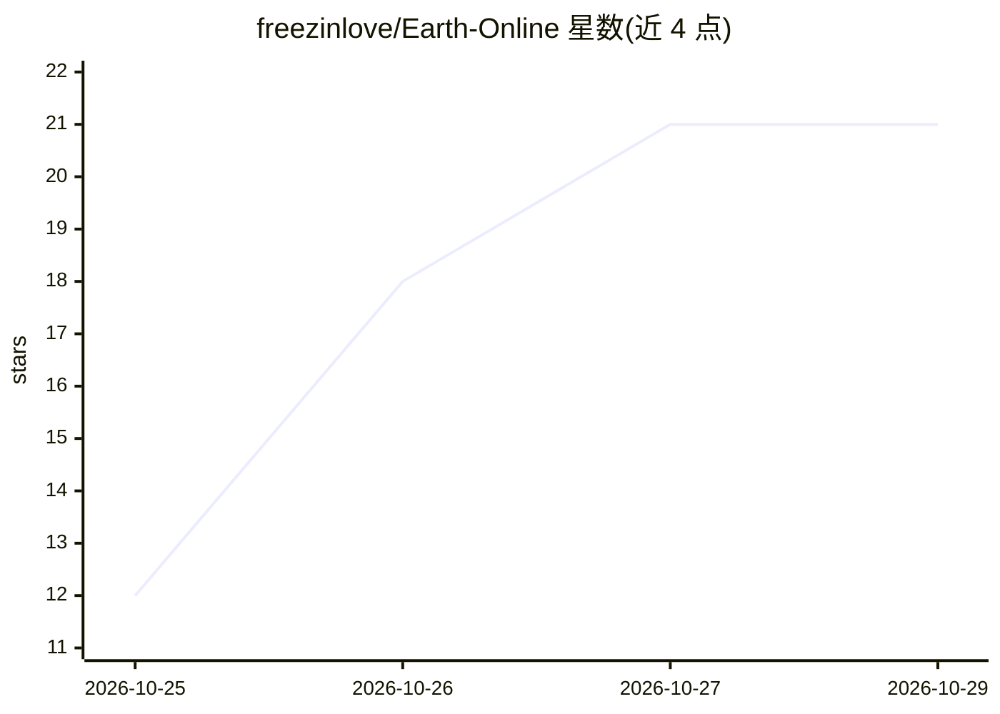

# freezinlove/Earth-Online

⭐ 21 · JavaScript · 推送 2026-05-24 · [GitHub](https://github.com/freezinlove/Earth-Online) · 个人维护 · 中文 README

**给旅行者：AI 自动整理照片并在 3D 地球上可视化**

面向普通用户的旅行照片归档应用：自动识别照片中的地点与行程，按时间和路线组织照片，在 3D 地球、时间线与旅行档案中呈现。支持带 GPS 元数据的照片导入，无 GPS 照片可借助邻近照片上下文定位；Embedding 为可选功能，关闭后浏览与整理仍可用。提供 Windows 桌面安装包与 Android APK；桌面单批导入最多 1000 张照片（建议 400 张以内），导入速度依赖本地网络与云端模型服务吞吐。开发调试需 Node.js 24+ 与 npm 11+。

## 筛选速览

| 维度 | 判定 | 备注 |
|---|---|---|
| AI 角色 | `ai-native` | 本体是模型或模型工具 |
| 许可风险 | `none` | — |
| 部署形态 | `desktop` | 安装包/桌面程序 |
| 模型依赖 | — | README 未给出锁定关系 |
| 硬件要求 | — | 无带数字的原话,不猜 |
| 安装摩擦 | `low` | 无编译、无系统依赖或容器化 |
| 成熟度 | `idea` | |

## 能力要点

- AI 识别照片地点并自动组织行程时间与路线
- 3D 地球、时间线与旅行档案三种浏览形式
- 无 GPS 照片可由邻近照片上下文辅助定位
- 提供 Windows 桌面安装包与 Android APK

## 适用场景

- 把散落的旅行照片自动归集成可回放的行程档案
- 在 3D 地球上按时间线浏览走过的地方
- 用手机整理和查看旅行照片

## 场景标签

`多模态` `图像视频处理` · 领域:感知与多模态

## 证据(README 行号)

> L7:  An automated private travel planet powered by AI.
> L9:  Earth_Online automatically understands your photos, recognizes the places in your trips, organizes time and routes,

## 星数曲线

2026-10-25 12 → 2026-10-29 21（+9）

---
*卡片 v1 · prompt 1.4 · 生成 2026-10-28 · 置信度 high · 依据 README sha `80d54db8133c` · [字段定义](../../DATASET.md)*
