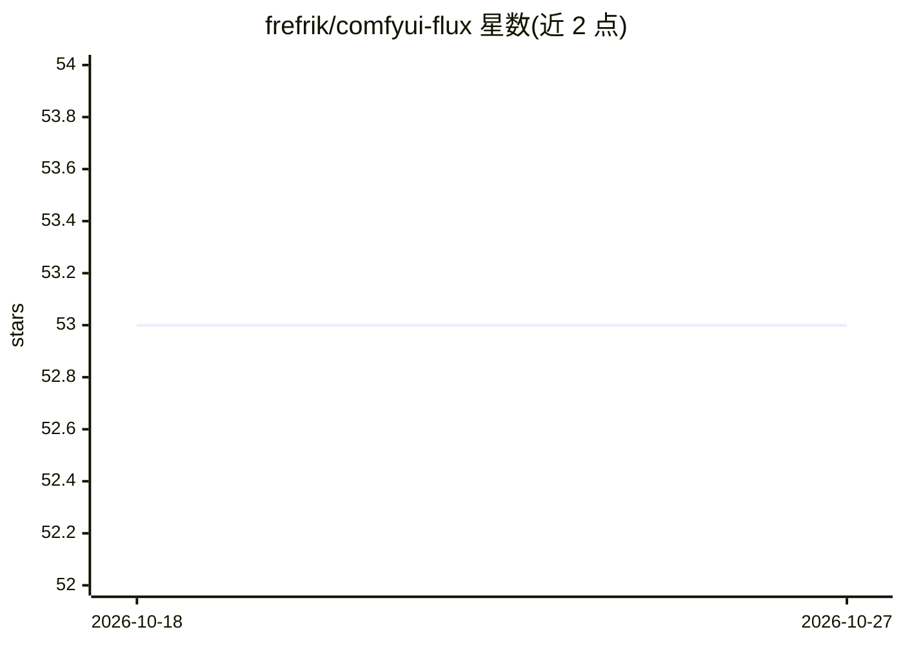

# frefrik/comfyui-flux

⭐ 53 · Shell · 推送 2026-01-07 · [GitHub](https://github.com/frefrik/comfyui-flux) · [官网](https://hub.docker.com/r/frefrik/comfyui-flux) · 个人维护

**用 Docker Compose 运行 ComfyUI 与 FLUX.1 模型的容器化部署方案**

以 Docker 镜像和 docker-compose 方式封装 ComfyUI 运行环境，自动安装 ComfyUI 与 ComfyUI-Manager，并预置 FLUX.1[dev]/[schnell] 模型、CLIP、VAE 与 LoRA 的下载流程。支持 CUDA 12.6/12.8/13.0 镜像标签，提供 LOW_VRAM 模式改用 FP8 模型降低显存占用，通过环境变量控制模型选择与 ComfyUI 命令行参数。面向具备 NVIDIA GPU 并希望快速搭建 ComfyUI 图像生成环境的开发者；下载官方 FLUX 模型需 Hugging Face token，首次启动需下载数十 GiB 模型文件。

## 筛选速览

| 维度 | 判定 | 备注 |
|---|---|---|
| AI 角色 | `ai-ecosystem` | LLM/agent 周边工具 |
| 许可风险 | `none` | — |
| 部署形态 | `self-host` | docker 或自建部署 |
| 模型依赖 | — | README 未给出锁定关系 |
| 硬件要求 | — | 无带数字的原话,不猜 |
| 安装摩擦 | `low` | 无编译、无系统依赖或容器化 |
| 成熟度 | — | 结构信号不足 |

## 能力要点

- Docker 化的 ComfyUI + ComfyUI-Manager 自动安装与更新
- LOW_VRAM 模式使用 FP8 模型（CLIP/VAE 已合并）降低显存占用
- CUDA 12.6/12.8/13.0 多版本镜像标签可选
- 通过环境变量选择下载 schnell/dev 模型，已存在文件跳过下载

## 适用场景

- 快速在本地 GPU 服务器上搭建 ComfyUI + FLUX 图像生成环境
- 显存有限的设备上用 FP8 模型运行 FLUX 工作流
- 用 docker-compose 统一管理 ComfyUI 及模型更新

## 场景标签

`图像生成` `推理引擎` · 领域:内容生成

## 证据(README 行号)

> L3: ComfyUI Flux is a Docker-based setup for running ComfyUI with FLUX.1 models and additional features.
> L7: - Dockerized ComfyUI environment

## 星数曲线

2026-10-18 53 → 2026-10-27 53（+0）

---
*卡片 v1 · prompt 1.4 · 生成 2026-10-24 · 置信度 high · 依据 README sha `e00073949f48` · [字段定义](../../DATASET.md)*
