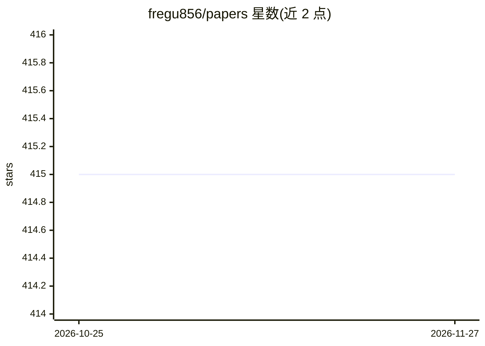

# fregu856/papers

⭐ 415 · 推送 2026-11-17 · [GitHub](https://github.com/fregu856/papers) · [官网](http://www.fregu856.com/) · 个人维护

**个人论文阅读笔记库：对600+篇ML论文分类、批注并写评论**

研究者个人维护的论文阅读记录仓库，自2018年起收录600余篇论文，按约37个类别（不确定性估计、目标检测、扩散模型、语言模型、计算病理学等）组织。每个条目包含论文标题、arXiv/bioRxiv 链接、发表 venue、类别标签、个人评论，多数附 annotated pdf（批注版 PDF）。当前展示的 2026 年阅读集中在计算病理学方向。纯静态笔记内容，无代码、无安装运行流程。

## 筛选速览

| 维度 | 判定 | 备注 |
|---|---|---|
| AI 角色 | `ai-knowledge` | 知识聚合/清单类 |
| 许可风险 | `none` | — |
| 部署形态 | `None` |  |
| 模型依赖 | — | README 未给出锁定关系 |
| 硬件要求 | — | 无带数字的原话,不猜 |
| 安装摩擦 | `low` | 无编译、无系统依赖或容器化 |
| 成熟度 | — | 结构信号不足 |

## 能力要点

- 600+ 篇论文按约37个主题类别分类组织
- 每条含个人评论与批注版 PDF 链接
- 记录发表 venue（NeurIPS、arXiv、bioRxiv 等）与阅读日期

## 适用场景

- 按主题浏览他人筛选和点评过的论文列表
- 阅读批注版 PDF 学习精读方式
- 了解计算病理学等方向的近期论文动态

## 场景标签

`精选清单` · 领域:学习与行业

## 证据(README 行号)

> L3: I categorize, annotate and write comments for all research papers I read (600+ papers since 2018).
> L9: [Uncertainty Estimation], [Ensembling], [Stochastic Gradient MCMC], [Variational Inference], [Out-of-Distribution De
> L11: ### Papers:

## 星数曲线

2026-10-25 415 → 2026-11-27 415（+0）

---
*卡片 v1 · prompt 1.4 · 生成 2026-11-25 · 置信度 high · 依据 README sha `a54f825d8cb9` · [字段定义](../../DATASET.md)*
