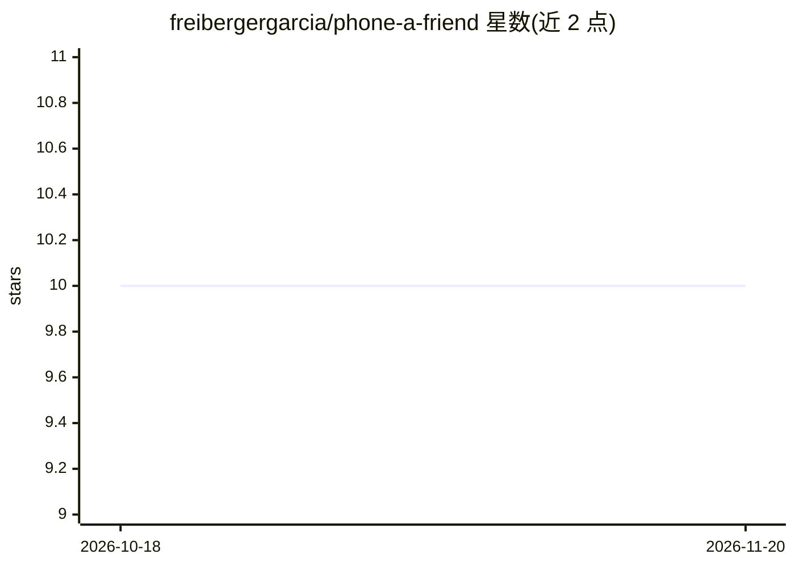

# freibergergarcia/phone-a-friend

⭐ 10 · TypeScript · Apache-2.0 · 推送 2026-11-13 · [GitHub](https://github.com/freibergergarcia/phone-a-friend) · [官网](https://phone-a-friend.space.fast) · 个人维护

**让编码 agent 在任务中调用另一模型的 CLI 中继**

开源 CLI，让 Claude Code、Codex、Gemini、Grok 等编码 agent 在任务进行中调用另一模型并把回答带回同一会话。支持三种模式：Relay 单次委派、Team 多轮迭代、Agentic 带 @mention 路由的持久多 agent 会话。后端涵盖 Antigravity、Claude、Codex、Gemini、Grok、xAI、Ollama、OpenCode、pi。通过 npm 全局安装，或以插件/skill 形式接入各宿主；需 Node.js 22.13+ 且至少一个后端 CLI。

## 筛选速览

| 维度 | 判定 | 备注 |
|---|---|---|
| AI 角色 | `ai-ecosystem` | LLM/agent 周边工具 |
| 许可风险 | `permissive` | Apache-2.0 |
| 部署形态 | `library` | 以包/库形式分发 |
| 模型依赖 | local-ok | 支持本地模型 |
| 硬件要求 | — | 无带数字的原话,不猜 |
| 安装摩擦 | `low` | 无编译、无系统依赖或容器化 |
| 成熟度 | — | 结构信号不足 |

## 能力要点

- Relay/Team/Agentic 三种委派模式
- 接入 9 个后端（含本地 Ollama 与 pi 本地模型）
- Claude Code/Codex/OpenCode/pi/Grok 的插件与 skill 自动安装
- setup 向导检测后端并验证，doctor 命令诊断问题

## 适用场景

- 让 Codex 审查我当前分支的代码改动
- 把同一个 bug 同时交给三个模型讨论
- 在 agent 会话中临时征求另一模型的设计意见

## 场景标签

`多智能体` `代码审查` `模型网关` · 领域:Agent 开发

## 证据(README 行号)

> L3:  An open-source CLI that lets your coding agent call another model in the middle of a task, and brings the answer ba
> L36: |**Relay**|One-shot delegation to Antigravity, Codex, Gemini, Ollama, Claude, OpenCode, pi, Grok, or xAI|Quick seco
> L81: npm install -g @freibergergarcia/phone-a-friend

## 星数曲线

2026-10-18 10 → 2026-11-20 10（+0）

---
*卡片 v1 · prompt 1.4 · 生成 2026-11-19 · 置信度 high · 依据 README sha `0e67619baacd` · [字段定义](../../DATASET.md)*
