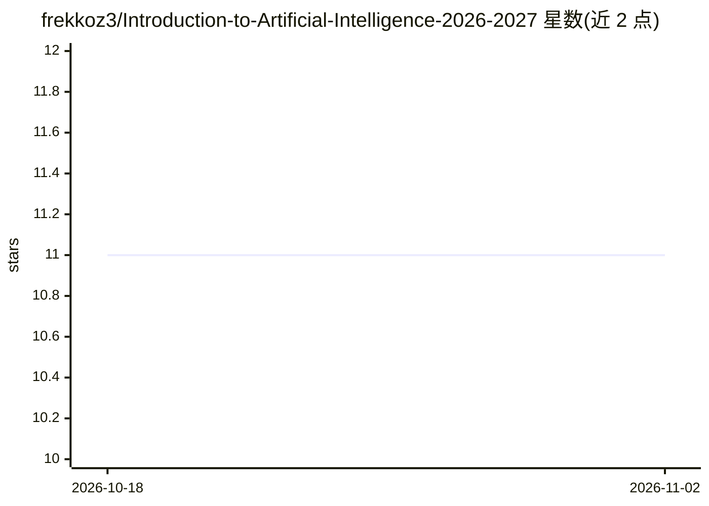

# frekkoz3/Introduction-to-Artificial-Intelligence-2026-2027

⭐ 11 · Jupyter Notebook · 推送 2026-10-29 · [GitHub](https://github.com/frekkoz3/Introduction-to-Artificial-Intelligence-2026-2027) · 组织维护

**的里雅斯特大学 AI 导论课程的辅导教学材料仓库**

University of Trieste 2026/2027 学年《人工智能导论》课程的辅导材料仓库，含每周更新的讲义 notebook、未完成练习（TODO 自行补全）、VS Code 配置指南与 Vacuum World 等交互式 Pygame 示例。运行方式：用 uv 同步锁定依赖（Python 3.12）启动 JupyterLab，或传统 pip 安装 requirements.txt；依赖由 pyproject.toml 与 uv.lock 维护，并附单元测试与 headless 检查命令。部分前几周答案尚未发布。

## 筛选速览

| 维度 | 判定 | 备注 |
|---|---|---|
| AI 角色 | `ai-knowledge` | 知识聚合/清单类 |
| 许可风险 | `none` | — |
| 部署形态 | `library` | 以包/库形式分发 |
| 模型依赖 | — | README 未给出锁定关系 |
| 硬件要求 | — | 无带数字的原话,不猜 |
| 安装摩擦 | `low` | 无编译、无系统依赖或容器化 |
| 成熟度 | — | 结构信号不足 |

## 能力要点

- 每周更新的讲义 notebook 与未完成练习
- uv 锁定依赖的 JupyterLab 快速启动流程
- VS Code 配置指南与截图资源
- 内置 unittest 测试与 uv lock 检查命令

## 适用场景

- 跟随 UniTS AI 导论课程完成每周练习
- 本地搭建 JupyterLab 环境运行课程 notebook
- 参考 Vacuum World 等 AI 教学示例代码

## 场景标签

`教程课程` · 领域:学习与行业

## 证据(README 行号)

> L3: This repository contains the tutoring material for the 2026/2027 Introduction to Artificial Intelligence at Universi
> L11: ├── notebooks/lectures/   # Lecture notebooks and exercises

## 星数曲线

2026-10-18 11 → 2026-11-02 11（+0）

---
*卡片 v1 · prompt 1.4 · 生成 2026-11-02 · 置信度 high · 依据 README sha `a5cb113343fb` · [字段定义](../../DATASET.md)*
