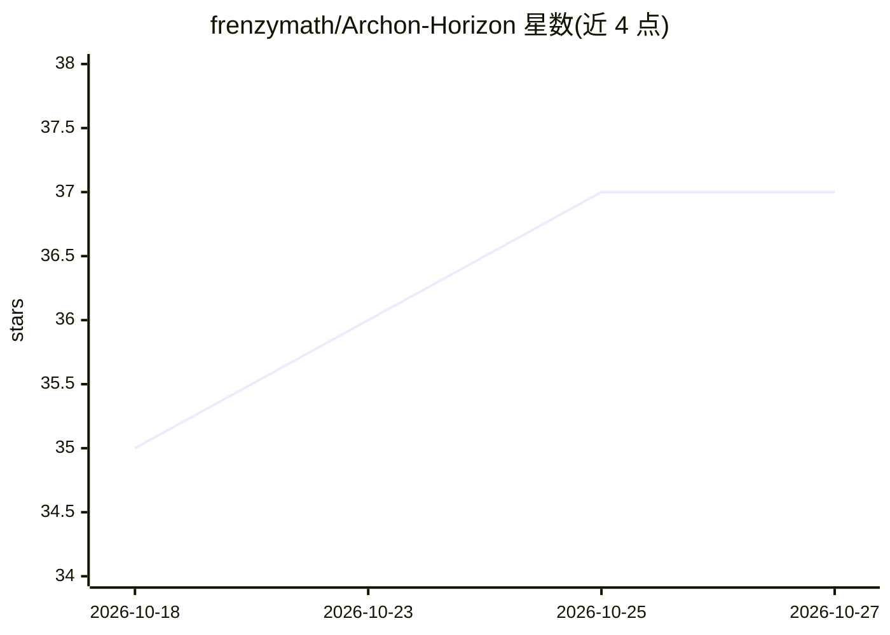

# frenzymath/Archon-Horizon

⭐ 37 · Python · Apache-2.0 · 推送 2026-10-09 · [GitHub](https://github.com/frenzymath/Archon-Horizon) · [官网](https://frenzymath.github.io/Archon-Horizon/demo/) · 组织维护

**协调多 worker 与 agent 的 Lean 4 自动形式化控制平面**

Archon Horizon 面向 Lean 4 形式化项目，提供分布式的控制平面：以 PostgreSQL 调度由目标（objectives）组成的任务树，按预处理、主形式化、后处理三阶段推进；agent 进程默认运行于 rootless Podman 容器中，可接入 Forgejo 与 Zulip 供人与 agent 协作，并附 Web dashboard 监控目标、形式化图与 agent 活动。安装需 Python 3.11+、源码构建另需 Node.js 20 与 npm，需配置 PostgreSQL。v0.2.0 为 alpha 版本，架构较 v0.1.5 有较大变化，官方建议仅用于新项目。

## 筛选速览

| 维度 | 判定 | 备注 |
|---|---|---|
| AI 角色 | `ai-ecosystem` | LLM/agent 周边工具 |
| 许可风险 | `permissive` | Apache-2.0 |
| 部署形态 | `None` |  |
| 模型依赖 | — | README 未给出锁定关系 |
| 硬件要求 | — | 无带数字的原话,不猜 |
| 安装摩擦 | `low` | 无编译、无系统依赖或容器化 |
| 成熟度 | `idea` | |

## 能力要点

- PostgreSQL 控制平面调度任务树并记录进度、发布到 Forge
- agent 默认运行于 rootless Podman 容器（镜像按 SHA-256 摘要固定）
- 预处理/主形式化/后处理三阶段可独立运行
- dashboard 聚合目标、形式化图、agent 活动与 Forgejo/Zulip 集成

## 适用场景

- 协调多台 worker 主机并行推进 Lean 形式化项目
- 从数学文献调研到形式化到库贡献的分阶段管理
- 通过 Zulip 与 dashboard 参与和监督 agent 的形式化工作

## 场景标签

`多智能体` `编码 Agent` · 领域:Agent 开发

## 证据(README 行号)

> L13: Archon Horizon coordinates automatic Lean formalization across projects and worker
> L15: criteria. One PostgreSQL control plane schedules their assignments, preserves
> L16: provider context, records progress, and reliably publishes work to Forge. Agents can coordinate through a Zulip ins

## 星数曲线

2026-10-18 35 → 2026-10-27 37（+2）

---
*卡片 v1 · prompt 1.4 · 生成 2026-10-25 · 置信度 high · 依据 README sha `b99d35c06e48` · [字段定义](../../DATASET.md)*
