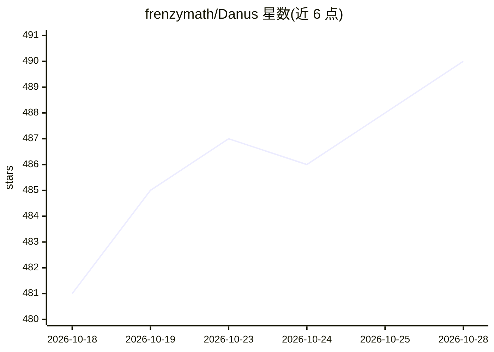

# frenzymath/Danus

⭐ 490 · Python · Apache-2.0 · 推送 2026-08-27 · [GitHub](https://github.com/frenzymath/Danus) · 组织维护 · 中文 README

**编排数学推理 agent 群的事实图记忆系统，产出证明与论文**

Danus 以事实图记忆编排数学推理多智能体：主 agent 分解问题并指挥 codex worker 群进行证明，冷启动验证者是唯一正确性仲裁，通过验证的结果累积进内容寻址的事实图，作为系统唯一事实来源。角色权限由 MCP 角色表强制（主 agent 无 fact_submit，验证者只读）。本分支主 agent 也运行于 codex，无需安装 Claude Code；另有 main 分支用 Claude Code 作编排器。结果可渲染为人类可读报告或可发表的 LaTeX 论文，论文成稿还会经专用 paper-math 验证器整体复核。运行需自带 API key（BYO）。

## 筛选速览

| 维度 | 判定 | 备注 |
|---|---|---|
| AI 角色 | `ai-ecosystem` | LLM/agent 周边工具 |
| 许可风险 | `permissive` | Apache-2.0 |
| 部署形态 | `None` |  |
| 模型依赖 | — | README 未给出锁定关系 |
| 硬件要求 | — | 无带数字的原话,不猜 |
| 安装摩擦 | `low` | 无编译、无系统依赖或容器化 |
| 成熟度 | — | 结构信号不足 |

## 能力要点

- 主 agent + codex worker 群 + 无状态验证者的三权分立架构
- 内容寻址事实图：真实运行 3,157 条已验证事实、8,616 条依赖边
- MCP 角色表强制权限分离（主 agent 无 fact_submit，验证者只读）
- write-paper 生成完整可编译论文并整体复核后交付

## 适用场景

- 组织多智能体协作攻克研究级数学证明问题
- 以事实图形式累积可验证的数学结果并追溯依赖
- 将证明结果自动撰写为可发表的 LaTeX 论文

## 场景标签

`多智能体` `科研工具` · 领域:Agent 开发

## 证据(README 行号)

> L11: Danus orchestrates mathematical reasoning agents with fact-graph memory. A main
> L13: cold-start verifier is the sole authority on correctness: a result becomes real
> L89: danus/                 the engine (installable Python package)

## 星数曲线

2026-10-18 481 → 2026-10-28 490（+9）

---
*卡片 v1 · prompt 1.4 · 生成 2026-10-23 · 置信度 high · 依据 README sha `57ec4ae66d4d` · [字段定义](../../DATASET.md)*
