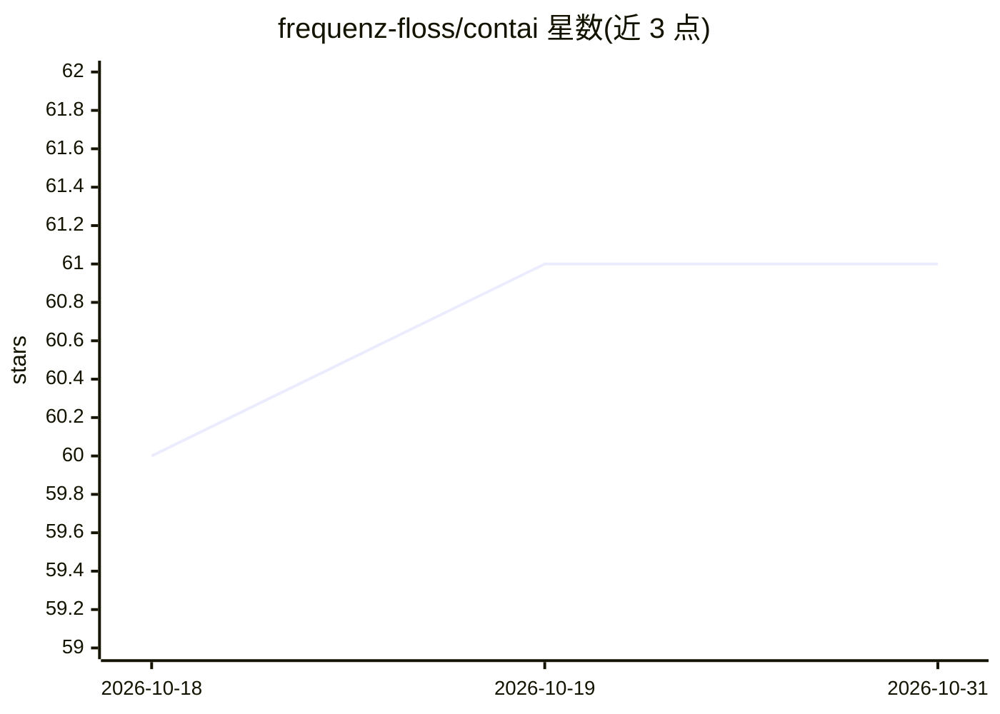

# frequenz-floss/contai

⭐ 61 · Shell · MIT · 推送 2026-10-28 · [GitHub](https://github.com/frequenz-floss/contai) · 组织维护

**在 Docker 沙箱中隔离运行 AI CLI 工具的容器封装**

面向不希望 AI CLI 工具访问整个系统的开发者：用 Docker 容器沙箱化运行 OpenCode、OpenAI Codex、GitHub Copilot、Google Gemini、Claude Code、RTK 等 AI CLI 工具，容器以主机 UID/GID 运行并自动挂载当前目录，配置与数据持久化在 ~/.local/share/contai/home。内置 ripgrep、git、Python、Node.js 等开发工具，pkgx 支持免 root 安装额外工具，可按工具名做符号链接直连启动。限制：目前主要用 OpenCode 测试；容器内无法访问主机浏览器，MCP OAuth 流程需在主机完成后手动拷贝凭据。

## 筛选速览

| 维度 | 判定 | 备注 |
|---|---|---|
| AI 角色 | `ai-ecosystem` | LLM/agent 周边工具 |
| 许可风险 | `permissive` | MIT |
| 部署形态 | `self-host` | docker 或自建部署 |
| 模型依赖 | — | README 未给出锁定关系 |
| 硬件要求 | — | 无带数字的原话,不猜 |
| 安装摩擦 | `low` | 无编译、无系统依赖或容器化 |
| 成熟度 | `idea` | |

## 能力要点

- 隔离 Docker 沙箱运行多种 AI CLI 工具，保护主机系统
- 主机 UID/GID 权限映射与持久化容器 home 目录
- 自动挂载当前工作目录并支持符号链接按工具名直接启动
- 可通过 docker-run-opts.list 传入任意 docker run 选项（含 --gpus=all）

## 适用场景

- 在不授予 AI CLI 工具全系统访问权的前提下使用它们
- 统一在容器内运行和管理多种 AI 编码 CLI
- 为 AI agent 提供带预装开发工具的隔离环境

## 场景标签

 · 领域:开发者工具/容器化

## 证据(README 行号)

> L3: `contai` is a very opinionated Docker-based sandbox for running AI CLI tools
> L9: - **Sandboxed Environment**: Runs AI CLI tools in an isolated Docker container

## 星数曲线

2026-10-18 60 → 2026-10-31 61（+1）

---
*卡片 v1 · prompt 1.4 · 生成 2026-10-24 · 置信度 high · 依据 README sha `8ff0c2e46725` · [字段定义](../../DATASET.md)*
