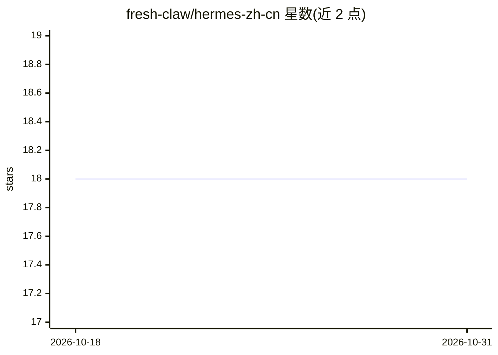

# fresh-claw/hermes-zh-cn

⭐ 18 · Shell · MIT · 推送 2026-08-22 · [GitHub](https://github.com/fresh-claw/hermes-zh-cn) · [官网](https://useai.live/hermes/) · 个人维护 · 中文 README

**Hermes Agent 桌面端/TUI/CLI 的中文汉化补丁安装器**

面向中文用户的 Hermes 中文增强包：提供一条安装命令，安装器检测本机 Hermes 是否安装（缺少时先执行官方安装），识别版本（0.15.x/0.14.x/0.13.x，失败用 legacy 兼容包），校验 SHA256 后将中文内容安装到 ~/.xiaoma-hermes/current，修改 hermes_cli 与 ui-tui 等源码文件实现界面汉化，写入 SKILL.md 供 Hermes 读取，并可选通过包装命令实现启动前自动更新。官网 useai.live/hermes 同时提供人读页面和 Hermes 可读的 agent.json/latest.json。

## 筛选速览

| 维度 | 判定 | 备注 |
|---|---|---|
| AI 角色 | `ai-ecosystem` | LLM/agent 周边工具 |
| 许可风险 | `permissive` | MIT |
| 部署形态 | `None` |  |
| 模型依赖 | — | README 未给出锁定关系 |
| 硬件要求 | — | 无带数字的原话,不猜 |
| 安装摩擦 | `low` | 无编译、无系统依赖或容器化 |
| 成熟度 | — | 结构信号不足 |

## 能力要点

- 支持 0.15.x/0.14.x/0.13.x 及 legacy 版本匹配
- 未安装官方 Hermes 时先执行官方安装再装中文补丁
- SHA256 校验后修改 CLI/TUI 源码文件实现中文显示
- 可选包装命令实现启动前检查并自动更新

## 适用场景

- 把 Hermes 桌面端/TUI/CLI 界面换成中文
- 安装后部分界面未汉化时补全中文显示
- 让 Hermes 保持中文包随版本自动更新

## 场景标签

 · 领域:开发工具/AI 本地化

## 证据(README 行号)

> L3: 面向中文用户的 Hermes Desktop 桌面版、Hermes Agent TUI 和 CLI 汉化补丁。适合刚开始用 Hermes、看不懂英文启动页和快捷指令、或者安装后仍有部分界面没有变成中文的人。
> L27: 7. 安装器检测 Hermes 程序目录，备份后修改 `hermes_cli/banner.py`、`hermes_cli/skin_engine.py`、`hermes_cli/tips.py`、`hermes_cli/comm
> L28: 8. 安装器写入 `~/.hermes/skills/xiaoma-hermes-zh/SKILL.md`，让 Hermes 知道本项目的中文说明、边界和更新方式。

## 星数曲线

2026-10-18 18 → 2026-10-31 18（+0）

---
*卡片 v1 · prompt 1.4 · 生成 2026-10-29 · 置信度 high · 依据 README sha `54905a6b3ae0` · [字段定义](../../DATASET.md)*
