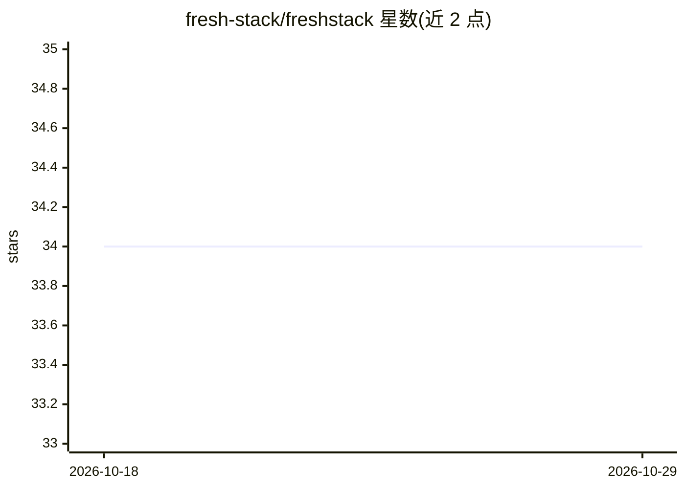

# fresh-stack/freshstack

⭐ 34 · Python · Apache-2.0 · 推送 2025-12-09 · [GitHub](https://github.com/fresh-stack/freshstack) · [官网](https://fresh-stack.github.io) · 个人维护

**从社区技术内容自动构建 IR/RAG 基准并评测检索模型**

模块化框架，从 StackOverflow 真实提问与 GitHub 仓库切分语料，自动构建贴近实际的 IR/RAG 基准数据集；支持对任意稠密/多向量嵌入模型做检索评测，示例接入 BEIR 与 PyLate（如 Qwen3、ColBERT）。已发布 5 个领域（langchain/yolo/laravel/angular/godot）的数据集（CC-BY-SA 4.0），代码 Apache 2.0，并提供在线排行榜。面向信息检索与 RAG 研究者，由滑铁卢大学与 Databricks 合作开发。

## 筛选速览

| 维度 | 判定 | 备注 |
|---|---|---|
| AI 角色 | `ai-ecosystem` | LLM/agent 周边工具 |
| 许可风险 | `permissive` | Apache-2.0 |
| 部署形态 | `library` | 以包/库形式分发 |
| 模型依赖 | — | README 未给出锁定关系 |
| 硬件要求 | — | 无带数字的原话,不猜 |
| 安装摩擦 | `low` | 无编译、无系统依赖或容器化 |
| 成熟度 | `idea` | |

## 能力要点

- 从 StackOverflow 提问与 GitHub 仓库自动构建基准语料
- 支持稠密/多向量模型的检索评测，示例基于 BEIR 与 PyLate
- 5 个领域数据集经 Hugging Face 发布
- 在线排行榜并提供模型提交贡献流程

## 适用场景

- 评测我的嵌入/检索模型在最新技术问答语料上的表现
- 为 RAG 系统选型对比检索模型
- 向排行榜提交自己的模型得分

## 场景标签

`模型评测` · 领域:评测与运维

## 证据(README 行号)

> L10: **FreshStack** is a modular framework to **automatically build realistic IR/RAG benchmarks** from niche, community-
> L14: * **Retrieval evaluation** of any dense/multi-vector model on the Freshstack repository.

## 星数曲线

2026-10-18 34 → 2026-10-29 34（+0）

---
*卡片 v1 · prompt 1.4 · 生成 2026-10-26 · 置信度 high · 依据 README sha `ec5676f7476a` · [字段定义](../../DATASET.md)*
