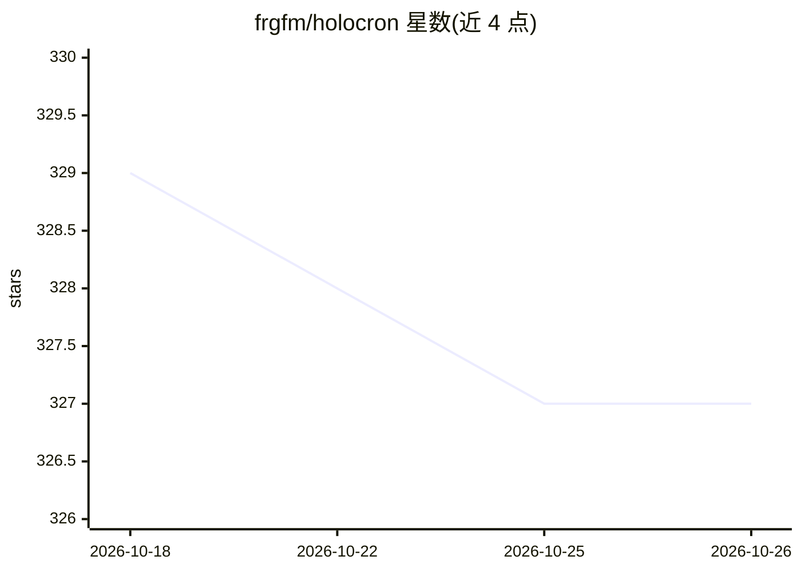

# frgfm/holocron

⭐ 327 · Python · Apache-2.0 · 推送 2026-10-22 · [GitHub](https://github.com/frgfm/holocron) · [官网](https://frgfm.github.io/holocron) · 个人维护

**PyTorch 计算机视觉模型与训练技巧研究实现库**

以 PyTorch 接口提供近年 CV 研究成果的实现：分类/检测/分割骨干网络（ResNet、ReXNet、RepVGG、YOLOv4、UNet3+ 等）、损失函数（PolyLoss、Focal Loss 等）、优化器（AdaBelief、AdEMAMix 等）与注意力、正则化等层。提供 31 个 Imagenette/ImageNet 预训练分类 checkpoint（无完整检测权重）、训练参考脚本、延迟基准、Gradio demo 与 FastAPI/Docker 部署模板。注意实现与论文作者代码可能有差异，torchvision/timm 权重不兼容。

## 筛选速览

| 维度 | 判定 | 备注 |
|---|---|---|
| AI 角色 | `ai-native` | 本体是模型或模型工具 |
| 许可风险 | `permissive` | Apache-2.0 |
| 部署形态 | `self-host` | docker 或自建部署 |
| 模型依赖 | — | README 未给出锁定关系 |
| 硬件要求 | — | 无带数字的原话,不猜 |
| 安装摩擦 | `low` | 无编译、无系统依赖或容器化 |
| 成熟度 | — | 结构信号不足 |

## 能力要点

- 覆盖分类/检测/分割的模型实现与预训练分类 checkpoint（共 31 个）
- 损失函数、优化器（含 AdEMAMix）、注意力等训练组件集合
- 提供训练参考脚本、延迟基准与 FastAPI/Docker 部署模板
- Gradio demo 与 Colab 快速上手 notebook

## 适用场景

- 在 PyTorch 项目中复用 ReXNet、RepVGG 等架构与预训练分类骨干
- 替换或实验新损失函数与优化器（如 PolyLoss、AdEMAMix）
- 用参考脚本在公开数据集上训练分类/检测/分割模型
- 通过 FastAPI 模板将 Holocron 模型部署为 REST API

## 场景标签

`目标检测` `模型训练` · 领域:感知与多模态

## 证据(README 行号)

> L44: Holocron provides research implementations with PyTorch interfaces.
> L115: - Image Classification: Res2Net (based on the great implementation from Ross Wightman), Darknet-24, Darknet-19, Da

## 星数曲线

2026-10-18 329 → 2026-10-26 327（-2）

---
*卡片 v1 · prompt 1.4 · 生成 2026-10-21 · 置信度 high · 依据 README sha `0dbd9dbcf6b4` · [字段定义](../../DATASET.md)*
