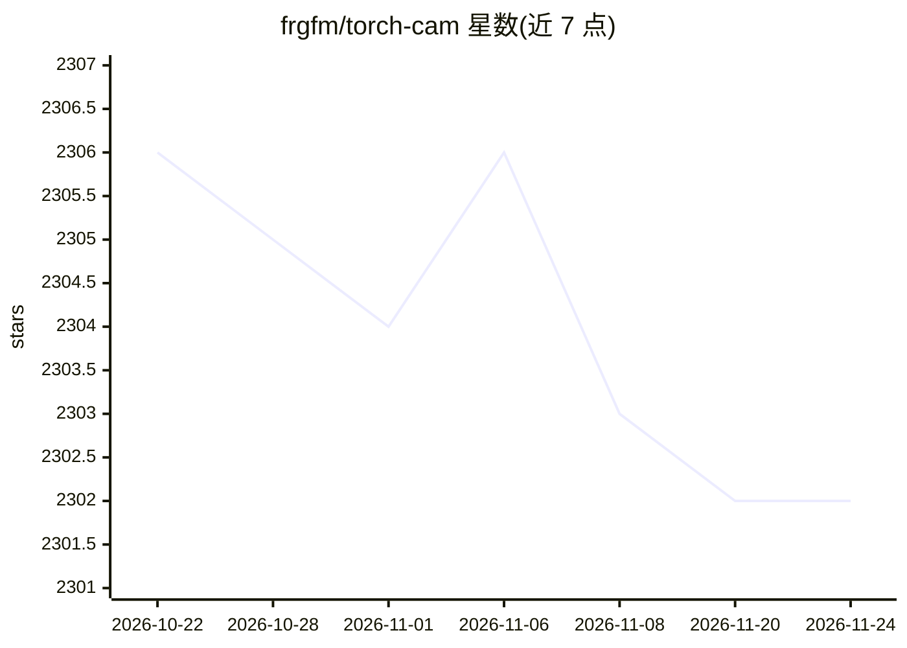

# frgfm/torch-cam

⭐ 2,302 · Python · Apache-2.0 · 推送 2026-11-23 · [GitHub](https://github.com/frgfm/torch-cam) · [官网](https://frgfm.github.io/torch-cam/) · 个人维护 · 中文 README

**为 PyTorch 模型生成类激活图的可解释性库**

基于 PyTorch hook 机制的类激活图提取库：包装用户的图像分类、检测、分割模型与文本决策模型，生成 13 种 CAM 方法（CAM、Grad-CAM 系列、Score-CAM 系列、EigenCAM、LeGrad、RefineCAM 等）的可视化热力图，并支持 ViT 的目标层自动解析与 token 贡献分析（TokenAblation/TokenIG）。仅 4 个运行时依赖（PyTorch、NumPy、Pillow、Matplotlib），内置忠实度指标（Average Drop、Increase in Confidence）。面向需要解释模型决策的 PyTorch 使用者，附带 Streamlit 演示应用与示例脚本。

## 筛选速览

| 维度 | 判定 | 备注 |
|---|---|---|
| AI 角色 | `ai-native` | 本体是模型或模型工具 |
| 许可风险 | `permissive` | Apache-2.0 |
| 部署形态 | `library` | 以包/库形式分发 |
| 模型依赖 | — | README 未给出锁定关系 |
| 硬件要求 | — | 无带数字的原话,不猜 |
| 安装摩擦 | `medium` | 含编译或系统依赖之一 |
| 成熟度 | — | 结构信号不足 |

## 能力要点

- 13 种 CAM 方法，覆盖 CNN 与 Vision Transformer
- 扩展到检测、分割、嵌入与文本分类的 token 归因（TokenAblation/TokenIG）
- 内置忠实度指标：Average Drop 与 Increase in Confidence
- explain() 输出可校验的 manifest 证据包，支持编码 agent 工作流

## 适用场景

- 调试分类器给出意外预测时定位关注的图像区域
- 为论文或模型审计生成激活图可视化
- 分析文本分类器中各 token 对决策的贡献
- 比较多种 CAM 方法在同一图像上的表现

## 场景标签

 · 领域:深度学习/模型可解释性

## 证据(README 行号)

> L39: Explain PyTorch decisions: activation maps for image classifiers, detectors, segmenters and VLMs, and token contrib
> L92: TorchCAM leverages PyTorch hooking mechanisms to seamlessly retrieve all required information to produce the class 
> L157: Python 3.11 or higher and uv/pip are required to install TorchCAM. TorchCAM requires PyTorch 2.13 or higher within

## 星数曲线

2026-10-22 2,306 → 2026-11-24 2,302（-4）

---
*卡片 v1 · prompt 1.4 · 生成 2026-11-23 · 置信度 mid · 依据 README sha `13ff47a399b0` · [字段定义](../../DATASET.md)*
