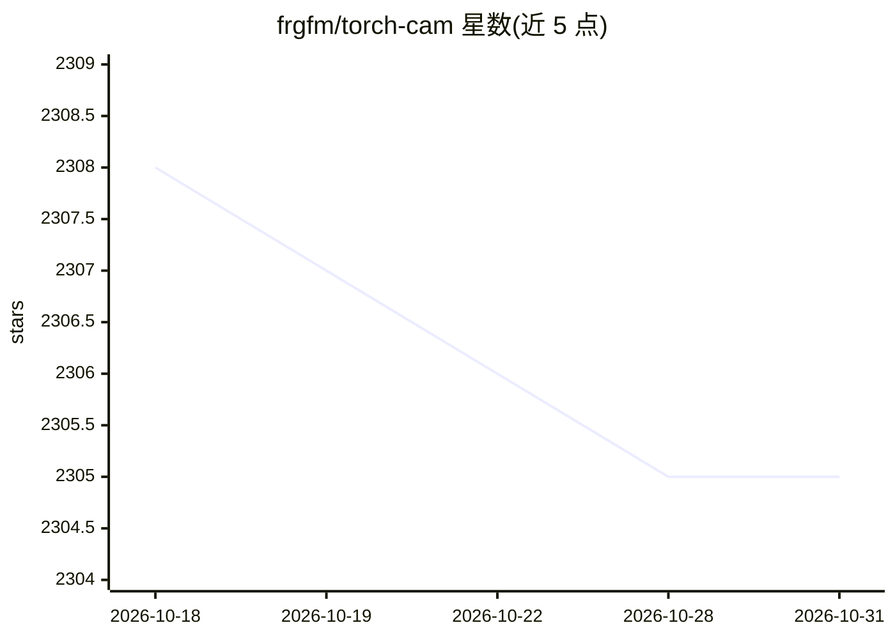

# frgfm/torch-cam

⭐ 2,305 · Python · Apache-2.0 · 推送 2026-10-30 · [GitHub](https://github.com/frgfm/torch-cam) · [官网](https://frgfm.github.io/torch-cam/) · 个人维护 · 中文 README

**为 PyTorch 模型生成类激活图（CAM）的可解释性库**

TorchCAM 是基于 PyTorch hook 机制的可解释性库：以包装器形式挂接用户模型，为图像分类、检测、分割及 VLM 生成 12 种 CAM 方法（CAM、Grad-CAM 系、Score-CAM 系、LayerCAM、LeGrad、RefineCAM 等）的类激活图/热力图，并为文本分类器提供 TokenAblation 与 TokenIG 两种 token 贡献度量；内置 average drop、increase in confidence 等忠实性指标。面向调试模型决策的开发者与研究者，运行时依赖仅 4 项（PyTorch、NumPy、Pillow、Matplotlib），另有 Streamlit 演示应用（BLIP、Qwen3-VL、Gemma、Laya 等）与基准脚本。0.5.0 版要求 PyTorch>=2.4.1、Python 3.11+；macOS 上使用官方 wheel 需 Apple Silicon。TokenAblation/TokenIG 仅在开发版可用。

## 筛选速览

| 维度 | 判定 | 备注 |
|---|---|---|
| AI 角色 | `ai-native` | 本体是模型或模型工具 |
| 许可风险 | `permissive` | Apache-2.0 |
| 部署形态 | `library` | 以包/库形式分发 |
| 模型依赖 | — | README 未给出锁定关系 |
| 硬件要求 | — | 无带数字的原话,不猜 |
| 安装摩擦 | `medium` | 含编译或系统依赖之一 |
| 成熟度 | — | 结构信号不足 |

## 能力要点

- 12 种 CAM 方法覆盖 CNN 与 Vision Transformer，自动解析目标层
- TokenAblation / TokenIG 度量文本分类器各 token 的类别贡献
- 内置 average drop、increase in confidence 等忠实性指标
- explain() 输出可由人类与编码 agent 校验的 manifest 证据包

## 适用场景

- 调试图像分类器为何给出某个预测结果
- 对比多种 CAM 方法在同一图像上的热力图
- 分析文本决策模型中各 token 对分类得分的影响
- 为 VLM 生成 token 级注意力归因图

## 场景标签

 · 领域:深度学习可解释性

## 证据(README 行号)

> L39: Explain PyTorch decisions: activation maps for image classifiers, detectors, segmenters and VLMs, and token contrib
> L50: - **12 CAM methods plus VLM token maps**: from CAM and Grad-CAM to LeGrad, RefineCAM and TAM.
> L92: TorchCAM leverages PyTorch hooking mechanisms to seamlessly retrieve all required information to produce the class 

## 星数曲线

2026-10-18 2,308 → 2026-10-31 2,305（-3）

---
*卡片 v1 · prompt 1.4 · 生成 2026-10-21 · 置信度 mid · 依据 README sha `3481d8a8691d` · [字段定义](../../DATASET.md)*
