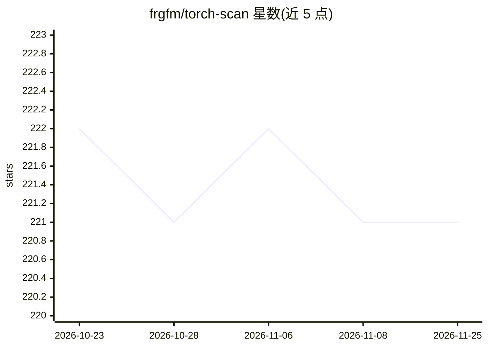

# frgfm/torch-scan

⭐ 221 · Python · Apache-2.0 · 推送 2026-11-23 · [GitHub](https://github.com/frgfm/torch-scan) · [官网](https://frgfm.github.io/torch-scan/) · 个人维护

**给 PyTorch 开发者度量模型资源开销的分析库**

面向 PyTorch 开发者的模型检查库：提供 summary/crawl_module 输出模块表、参数量、存储与 FLOPs 估计，workload 计时 API 采集延迟、吞吐、内存与进程 RSS，compare_benchmarks 对比基线与变更并输出误差清单，报告可存为 JSON 或离线 HTML。每项指标带 method/scope/completeness 状态（complete/partial/unavailable）。要求 Python ≥3.11 与 PyTorch ≥2.1；计时与报告 API 需安装 main 分支，0.3.0 尚未发布。

## 筛选速览

| 维度 | 判定 | 备注 |
|---|---|---|
| AI 角色 | `ai-native` | 本体是模型或模型工具 |
| 许可风险 | `permissive` | Apache-2.0 |
| 部署形态 | `library` | 以包/库形式分发 |
| 模型依赖 | — | README 未给出锁定关系 |
| 硬件要求 | — | 无带数字的原话,不猜 |
| 安装摩擦 | `medium` | 含编译或系统依赖之一 |
| 成熟度 | — | 结构信号不足 |

## 能力要点

- summary 返回 AnalysisReport：形状、参数、存储、模块公式计数与算子 FLOPs
- workload 计时采集延迟、吞吐、内存与新鲜进程峰值 RSS
- compare_benchmarks 带 keep/discard/inconclusive 检查结果
- 指标携带 completeness 状态，区分完整值、下界与不可用

## 适用场景

- 训练前后检查模型的 FLOPs、参数量与存储
- 对比同一模型修改前后的延迟与内存变化
- 为模型选型导出可复用的 JSON/HTML 资源报告

## 场景标签

`模型评测` · 领域:评测与运维

## 证据(README 行号)

> L15: TorchScan helps you **inspect model cost, measure actual resource use, check an optimization, and consume the repor
> L81: module-formula counts, and separate operator FLOPs for an evaluation forward. It disables gradients temporarily and
> L113: Stable model inspection: `python -m pip install torchscan==0.2.0`. Requirements are Python ≥3.11,<4 and PyTorch ≥2

## 星数曲线

2026-10-23 222 → 2026-11-25 221（-1）

---
*卡片 v1 · prompt 1.4 · 生成 2026-11-25 · 置信度 high · 依据 README sha `50f1b5c09859` · [字段定义](../../DATASET.md)*
