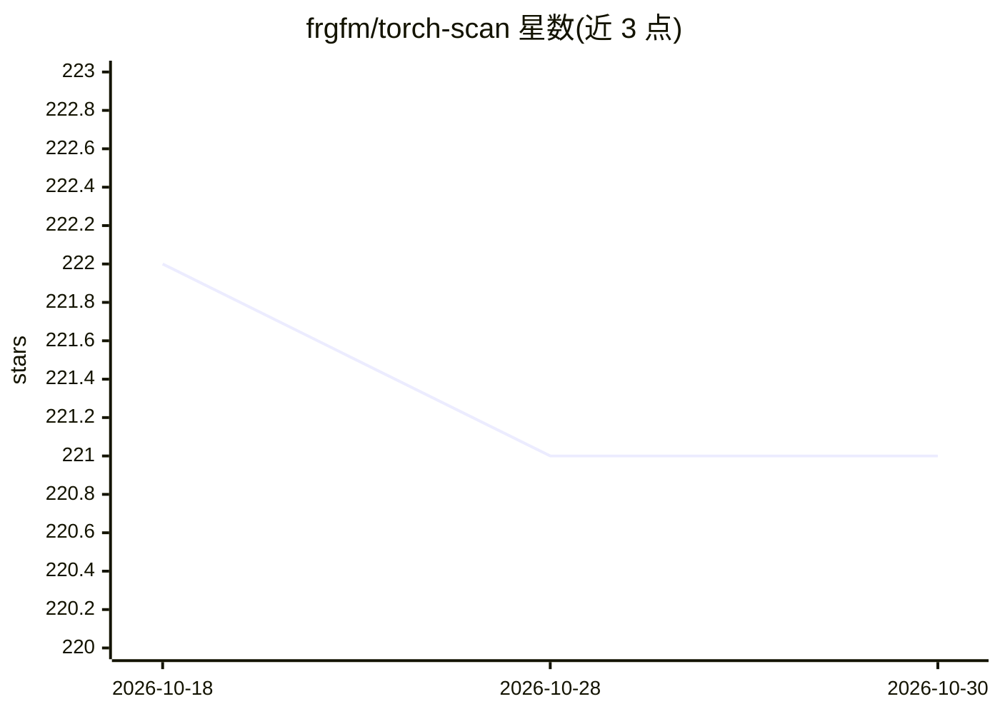

# frgfm/torch-scan

⭐ 221 · Python · Apache-2.0 · 推送 2026-10-29 · [GitHub](https://github.com/frgfm/torch-scan) · [官网](https://frgfm.github.io/torch-scan/) · 个人维护

**PyTorch 模型开销分析与基准测量库（FLOPs/显存/时延）**

面向 PyTorch 开发者的模型分析工具库：`summary`/`crawl_module` 输出模块表、参数量、存储与模块级/算子级 FLOPs；workload API 测量实际时延并生成 JSON 与离线 HTML 报告；`compare_benchmarks` 用于在同一硬件上做基线与变更对比。指标附带方法、范围与完整性状态（complete/partial/unavailable），文档明确区分模型存储与峰值内存、理论 FLOPs 与实测时延的边界。当前 PyPI 发布 0.2.0 仅含模型检查，workload API 需安装 main 分支；要求 Python ≥3.11、PyTorch ≥2.1。Apache 2.0 许可。

## 筛选速览

| 维度 | 判定 | 备注 |
|---|---|---|
| AI 角色 | `ai-ecosystem` | LLM/agent 周边工具 |
| 许可风险 | `permissive` | Apache-2.0 |
| 部署形态 | `library` | 以包/库形式分发 |
| 模型依赖 | — | README 未给出锁定关系 |
| 硬件要求 | — | 无带数字的原话,不猜 |
| 安装摩擦 | `medium` | 含编译或系统依赖之一 |
| 成熟度 | — | 结构信号不足 |

## 能力要点

- summary/crawl_module 输出形状、参数、存储与 FLOPs 报告
- workload API 测量时延并生成 JSON/离线 HTML 报告
- compare_benchmarks 支持带输出容差的基线对比
- 指标携带方法、范围与完整性状态（complete/partial/unavailable）

## 适用场景

- 检查模型的 FLOPs、参数量与内存开销
- 在同一硬件上对比优化前后的时延与资源占用
- 将测量结果以 JSON/HTML 形式留存与消费

## 场景标签

 · 领域:深度学习工具链

## 证据(README 行号)

> L15: TorchScan helps you **inspect model cost, measure actual resource use, check an optimization, and consume the repor
> L55: `summary` prints the familiar module table and returns an `AnalysisReport`: shapes, parameters, storage,
> L60: Workload measurement produces `BenchmarkReport` evidence for the callable you supply. Model storage is not peak

## 星数曲线

2026-10-18 222 → 2026-10-30 221（-1）

---
*卡片 v1 · prompt 1.4 · 生成 2026-10-22 · 置信度 high · 依据 README sha `5417f866f63c` · [字段定义](../../DATASET.md)*
