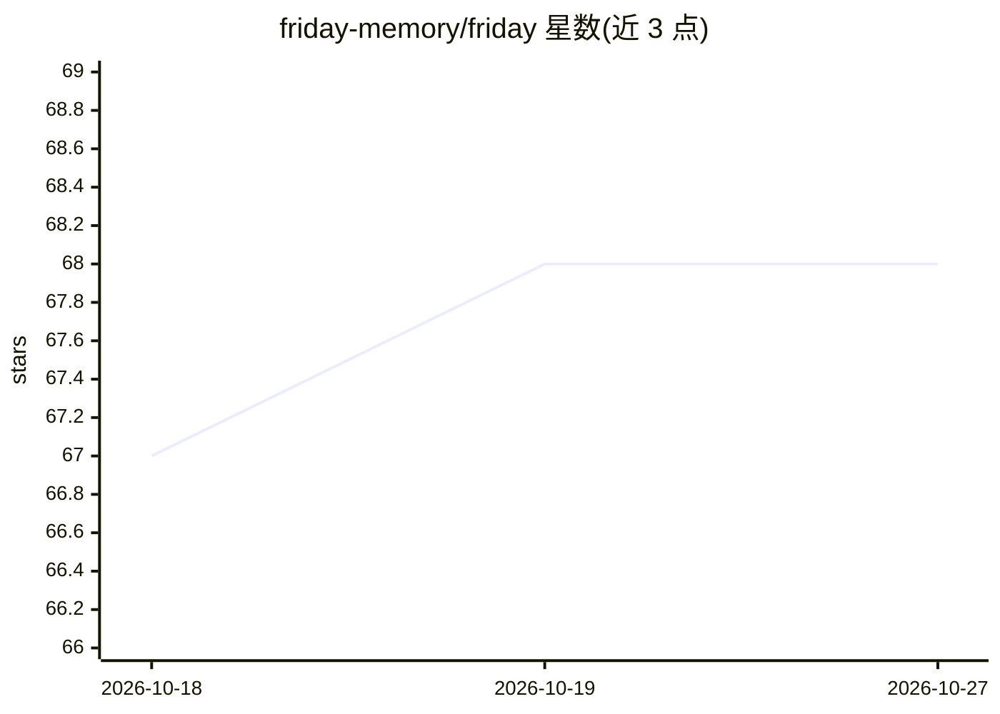

# friday-memory/friday

⭐ 68 · Python · MIT · 推送 2026-10-23 · [GitHub](https://github.com/friday-memory/friday) · [官网](https://pypi.org/project/friday-memory/) · 组织维护

**为 AI 编程 agent 提供跨会话持久记忆层的自托管服务**

以自托管后台服务形式运行的持久认知记忆层，通过 Model Context Protocol (MCP) 供 Cursor、Claude Code、Antigravity、VS Code 等 AI 编程客户端调用，解决会话遗忘问题。采用四层记忆结构：版本化事实账本（SQLite/JSON）、Mem0 情景记忆、ChromaDB 向量嵌入、Neo4j 关系图。采用双引擎架构，前台编程 agent 与后台 worker LLM（Groq/DeepSeek/Ollama/vLLM）解耦，每日 03:00 UTC 运行 Dream Cycle 做记忆衰减与固化。提供安装脚本与 Docker Compose 部署，需 Python 3.11+ 并占用端口 8000/7474/7687。

## 筛选速览

| 维度 | 判定 | 备注 |
|---|---|---|
| AI 角色 | `ai-ecosystem` | LLM/agent 周边工具 |
| 许可风险 | `permissive` | MIT |
| 部署形态 | `self-host` | docker 或自建部署 |
| 模型依赖 | local-ok | 支持本地模型 |
| 硬件要求 | — | 无带数字的原话,不猜 |
| 安装摩擦 | `low` | 无编译、无系统依赖或容器化 |
| 成熟度 | — | 结构信号不足 |

## 能力要点

- 四层记忆结构：事实账本/情景记忆/向量嵌入/Neo4j 关系图
- 双引擎架构：前台 agent 与后台 worker LLM 解耦，MCP 调用响应 < 40ms
- Dream Cycle 夜间任务：突触衰减、记忆剪枝、Git 自动快照
- Neural Studio 3D WebGL 知识图谱可视化

## 适用场景

- 让 Cursor/Claude Code 等编程 agent 跨会话记住架构决策与约束
- 通过关系图查询改动的波及范围（如表改动影响哪些端点）
- 以 Docker Compose 自托管方式为团队提供统一记忆服务

## 场景标签

`Agent 记忆` · 领域:Agent 开发

## 证据(README 行号)

> L5: **Self-hosted persistent cognitive memory layer for AI coding agents.**
> L7: Persists architecture decisions, schemas, and constraints across sessions via the Model Context Protocol (MCP).
> L54: Friday runs as a self-hosted background service providing a structured, four-tier memory substrate accessed via the

## 星数曲线

2026-10-18 67 → 2026-10-27 68（+1）

---
*卡片 v1 · prompt 1.4 · 生成 2026-10-24 · 置信度 mid · 依据 README sha `adbf38fdb1a6` · [字段定义](../../DATASET.md)*
