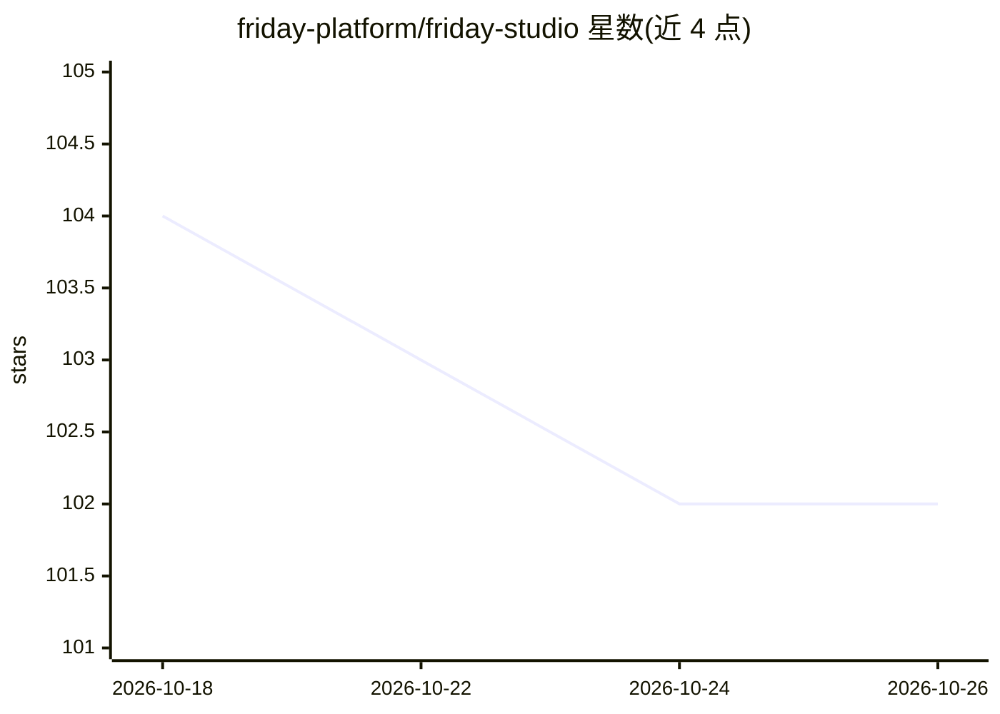

# friday-platform/friday-studio

⭐ 102 · TypeScript · NOASSERTION · 推送 2026-09-05 · [GitHub](https://github.com/friday-platform/friday-studio) · [官网](https://docs.hellofriday.ai) · 组织维护

**自托管 agent 工作流平台：对话生成可版本化的自动化工作流**

由 atlasd 守护进程与 SvelteKit Playground 两个层面组成的 agent 编排平台：用户在聊天中用自然语言描述任务，产出可阅读、可版本化的 workspace.yml（agent、MCP 工具、信号、任务编排），由守护进程按 cron/webhook/HTTP 信号本地调度执行。agent 可用 TypeScript 或 Python（经 friday-agent-sdk）编写，内置 MCP 服务器管理、技能、记忆与工作流市场。需自装 Node.js 与 git，脚本负责 Deno/Go/uv/nats-server 等依赖，Docker 可选；Business Source License 1.1 源码可得许可。

## 筛选速览

| 维度 | 判定 | 备注 |
|---|---|---|
| AI 角色 | `ai-ecosystem` | LLM/agent 周边工具 |
| 许可风险 | `none` | NOASSERTION |
| 部署形态 | `self-host` | docker 或自建部署 |
| 模型依赖 | — | README 未给出锁定关系 |
| 硬件要求 | — | 无带数字的原话,不猜 |
| 安装摩擦 | `low` | 无编译、无系统依赖或容器化 |
| 成熟度 | — | 结构信号不足 |

## 能力要点

- 对话产出可版本化/分享的 workspace.yml，绑定 cron/webhook/HTTP 信号自动执行
- atlasd 守护进程 + SvelteKit Playground 双层面架构，会话逐步可回放
- agent 支持 TypeScript 与 Python（friday-agent-sdk，经 uv 运行）
- 内置 MCP 服务器浏览/测试面板、技能编辑、记忆、工作流市场

## 适用场景

- 把一次性聊天自动化固化为可复跑的定时工作流（如每天处理收件箱、审查 PR）
- 用 MCP 工具与浏览器 agent 搭建监控类自动化并推送 Slack
- 团队间以 workspace.yml 分享与复用自动化流程

## 场景标签

`Agent 框架` `工作流自动化` · 领域:Agent 开发

## 证据(README 行号)

> L16: (HTTP, cron, Slack, email, webhook), and the jobs that wire them together.
> L25: - **Run autonomously.** Capture the pattern in a `workspace.yml`, bind it
> L43: |**`atlasd` (daemon)**|Headless runtime — HTTP API on `:8080`, workspace lifecycle, signal router, session state, J

## 星数曲线

2026-10-18 104 → 2026-10-26 102（-2）

---
*卡片 v1 · prompt 1.4 · 生成 2026-10-23 · 置信度 mid · 依据 README sha `7acd7f089e99` · [字段定义](../../DATASET.md)*
