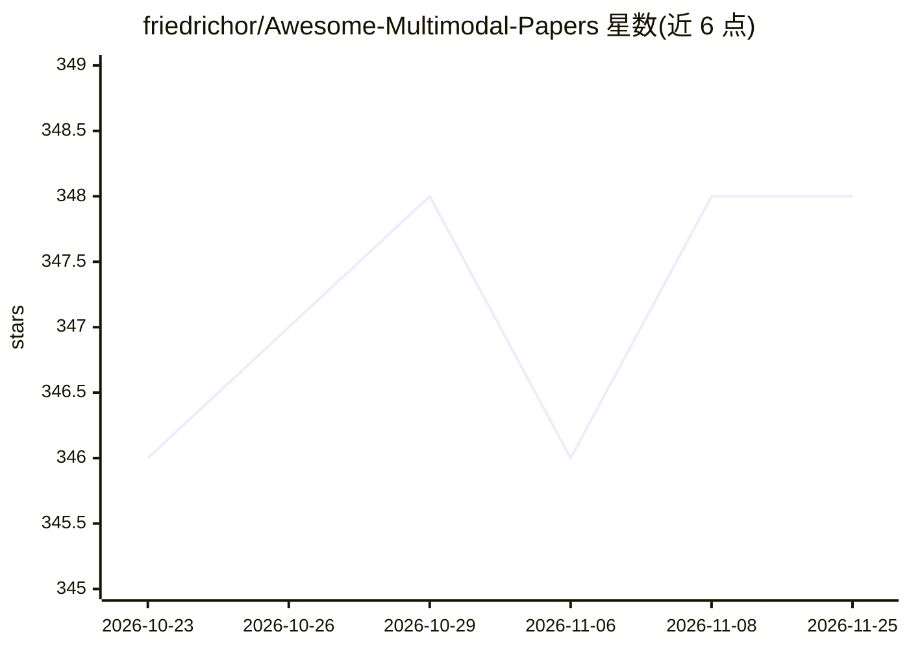

# friedrichor/Awesome-Multimodal-Papers

⭐ 348 · MIT · 推送 2026-11-18 · [GitHub](https://github.com/friedrichor/Awesome-Multimodal-Papers) · [官网](https://friedrichor.github.io/Awesome-Multimodal-Papers/) · 个人维护

**多模态研究论文策展清单：供研究者追踪文献**

维护多模态研究论文的聚合清单，按基础模型、视觉理解等章节组织条目，每条记录论文标题、发表会议/平台、日期、代码仓库及补充材料（项目页、数据集、博客合集）链接。接受社区通过 issue 按规定格式提交论文，收录 DeepSeek-V4、GLM-5、Kimi K2.5、Qwen3-VL、InternVL3 等模型报告及视频理解、视觉 token 压缩、多模态指令微调等方向论文。本身不含代码或安装流程，仅作为文献索引使用。

## 筛选速览

| 维度 | 判定 | 备注 |
|---|---|---|
| AI 角色 | `ai-knowledge` | 知识聚合/清单类 |
| 许可风险 | `permissive` | MIT |
| 部署形态 | `None` |  |
| 模型依赖 | — | README 未给出锁定关系 |
| 硬件要求 | — | 无带数字的原话,不猜 |
| 安装摩擦 | `low` | 无编译、无系统依赖或容器化 |
| 成熟度 | — | 结构信号不足 |

## 能力要点

- 按章节（基础模型/视觉理解等）组织的论文条目表格
- 每条标注 venue、日期、代码链接与补充材料（项目页/数据集/博客）
- 接受社区按指定 JSON 格式通过 issue 提交论文
- 收录模型技术报告与配套数据集、项目页链接

## 适用场景

- 查找多模态大模型方向的相关论文与代码实现
- 跟踪视频理解、视觉 token 压缩等子方向的进展
- 按格式提交自己或发现的多模态研究论文

## 场景标签

`科研工具` `精选清单` · 领域:学习与行业

## 证据(README 行号)

> L3: A curated list of awesome Multimodal studies.
> L20: ### Foundation Model (Textual and Multimodal)

## 星数曲线

2026-10-23 346 → 2026-11-25 348（+2）

---
*卡片 v1 · prompt 1.4 · 生成 2026-11-25 · 置信度 high · 依据 README sha `6eb154b42bf0` · [字段定义](../../DATASET.md)*
