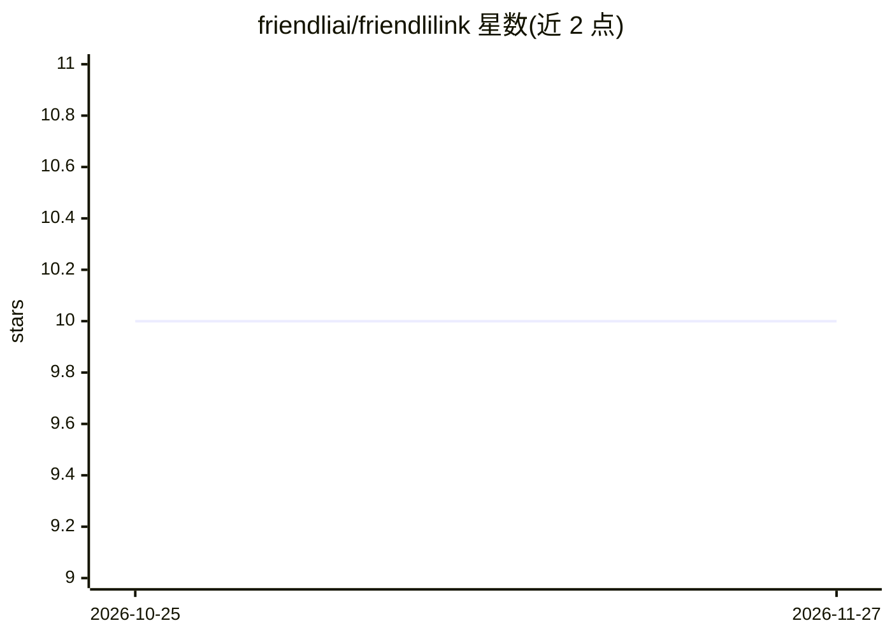

# friendliai/friendlilink

⭐ 10 · TypeScript · Apache-2.0 · 推送 2026-11-26 · [GitHub](https://github.com/friendliai/friendlilink) · 组织维护

**将多种编码 agent 的配置切换为通过 FriendliAI 运行的 CLI 工具**

FriendliLink（frlink）是一个集成配置工具：检测本机已安装的编码 agent（Claude Code、Codex、Cursor、OpenCode、Pi、Hermes Agent、DeepSeek Harness），通过改写其 provider 设置（API key、base URL、模型映射）将其路由到 FriendliAI，并可一键恢复原配置。API key 存入系统钥匙串，带降级文件存储。通过 curl 安装脚本或克隆仓库构建，需 Node.js ≥ 18。

## 筛选速览

| 维度 | 判定 | 备注 |
|---|---|---|
| AI 角色 | `ai-ecosystem` | LLM/agent 周边工具 |
| 许可风险 | `permissive` | Apache-2.0 |
| 部署形态 | `library` | 以包/库形式分发 |
| 模型依赖 | — | README 未给出锁定关系 |
| 硬件要求 | — | 无带数字的原话,不猜 |
| 安装摩擦 | `low` | 无编译、无系统依赖或容器化 |
| 成熟度 | — | 结构信号不足 |

## 能力要点

- 一条命令连接/断开单个或全部已安装 agent（on/off/status）
- Claude Code 按 slot 的模型映射（opus/sonnet/haiku 各指定 FriendliAI 模型）
- API key 保存到 OS keychain，带 owner-only 权限文件回退
- 支持 Hermes/DeepSeek Harness 的多 profile 配置

## 适用场景

- 让 Claude Code / Codex 等 agent 走 FriendliAI 的模型目录
- 在多个编码 agent 间统一切换 provider 并可还原原设置
- 为 Hermes、dsh 按 profile 配置不同的路由

## 场景标签

`模型网关` · 领域:Agent 开发

## 证据(README 行号)

> L5: > Use FriendliAI models in Claude Code, OpenCode, Codex, Pi, Cursor, Hermes Agent, and DeepSeek Harness.
> L7: `frlink` wires the agent's provider settings (API key, base URL, model) to run through FriendliAI, and can restore t
> L9: Supported agents: **Claude Code CLI**, **Cursor Desktop / IDE**, **Codex CLI**, **OpenCode**, **Pi**, **Hermes Agent

## 星数曲线

2026-10-25 10 → 2026-11-27 10（+0）

---
*卡片 v1 · prompt 1.4 · 生成 2026-11-19 · 置信度 high · 依据 README sha `ee307230e6f2` · [字段定义](../../DATASET.md)*
