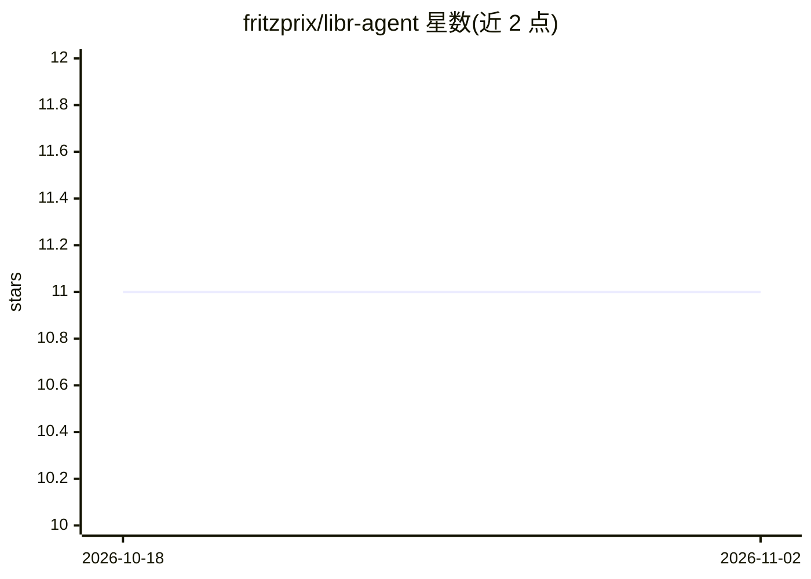

# fritzprix/libr-agent

⭐ 11 · Rust · MIT · 推送 2026-11-01 · [GitHub](https://github.com/fritzprix/libr-agent) · [官网](https://fritzprix.github.io/libr-agent/) · 个人维护 · 中文 README

**本地优先的桌面 AI agent 运行环境：选模型、装工具、选编排模式**

基于 Tauri（Rust/React/TypeScript）的桌面应用，作为本地 agent 运行环境：用户粘贴 OpenAI/Anthropic/Gemini/Groq API key 或连接本地 Ollama 选择模型；通过 Extensions 一键安装 MCP 工具预设（GitHub、Brave Search、Filesystem），或从 Cursor/VS Code/Claude Code/Windsurf 导入配置；以内置技能形式提供 pipeline、hub-spoke、divide-conquer 等多 agent 协作模式；产物保存为本地文件。含 15+ 内置 MCP 服务器、图式知识库与 BM25 检索、定时任务、HTTP API。提供 Windows/macOS/Linux 安装包，MIT 许可，也可从源码用 pnpm tauri 运行。

## 筛选速览

| 维度 | 判定 | 备注 |
|---|---|---|
| AI 角色 | `ai-ecosystem` | LLM/agent 周边工具 |
| 许可风险 | `permissive` | MIT |
| 部署形态 | `desktop` | 安装包/桌面程序 |
| 模型依赖 | local-ok | 支持本地模型 |
| 硬件要求 | — | 无带数字的原话,不猜 |
| 安装摩擦 | `low` | 无编译、无系统依赖或容器化 |
| 成熟度 | — | 结构信号不足 |

## 能力要点

- 一键安装 MCP 工具预设，支持从 Cursor/VS Code/Claude Code/Windsurf 导入配置
- pipeline/hub-spoke/divide-conquer 等 8 类协作模式以内置技能形式提供
- 15+ 内置 MCP 服务器（Workspace/Shell/Browser/Knowledge 等），工具按会话隔离并含路径与命令防护
- 云 API key 与本地 Ollama 双通道，工作区/会话/技能默认留在本地

## 适用场景

- 不写 JSON、不用终端，在桌面端搭建多 agent 工作流并生成文件交付物
- 每日定时运行 Morning Briefing 等自动化工作流生成简报
- 隐私敏感场景下接本地 Ollama 模型，全程零云端传输

## 场景标签

`多智能体` `工作流自动化` `AI 助手` · 领域:Agent 开发

## 证据(README 行号)

> L5: > **A local agent operating environment. Select your model, install tools with one click, and choose a coordination 
> L30: |Assemble multi-agent systems from code|**Standard coordination patterns** as bundled skills (`pipeline`, `hub-spok
> L58: - Cloud: Paste an API key for OpenAI, Anthropic, Gemini, or Groq.

## 星数曲线

2026-10-18 11 → 2026-11-02 11（+0）

---
*卡片 v1 · prompt 1.4 · 生成 2026-11-02 · 置信度 mid · 依据 README sha `d5d88d746ead` · [字段定义](../../DATASET.md)*
