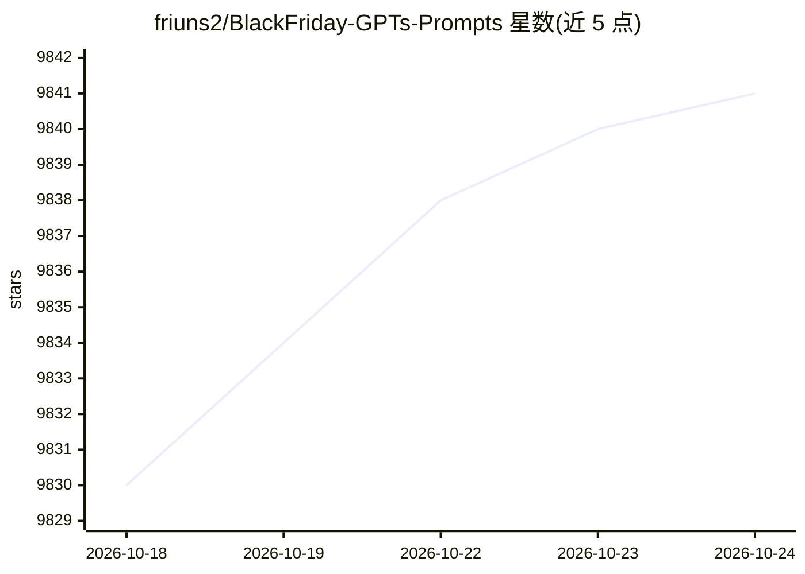

# friuns2/BlackFriday-GPTs-Prompts

⭐ 9,845 · MIT · 推送 2026-03-18 · [GitHub](https://github.com/friuns2/BlackFriday-GPTs-Prompts) · [官网](https://play.google.com/store/apps/details?id=gptos.intelligence.assistant) · 个人维护

**免费 GPT 与提示词/越狱清单（分类汇编）**

以 awesome-list 形式收录无需 Plus 订阅即可使用的免费 GPT、提示词与越狱（jailbreak）提示，按 Programming、Marketing、Academic、Job Hunting、Game、Creative、Business、Productivity 等约 12 个类别组织，更新标注至 2024 年 5 月。README 顶部另展示 AnyClaw（OpenClaw + Codex 的 Android APK）的下载指引，与清单主体内容不同源。仓库不提供本产品的安装命令或代码运行方式，仅作为条目索引使用。

## 筛选速览

| 维度 | 判定 | 备注 |
|---|---|---|
| AI 角色 | `ai-knowledge` | 知识聚合/清单类 |
| 许可风险 | `permissive` | MIT |
| 部署形态 | `None` |  |
| 模型依赖 | — | README 未给出锁定关系 |
| 硬件要求 | — | 无带数字的原话,不猜 |
| 安装摩擦 | `low` | 无编译、无系统依赖或容器化 |
| 成熟度 | — | 结构信号不足 |

## 能力要点

- 按约 12 个类别组织的免费 GPT 与提示词条目
- 收录无需 Plus 订阅即可访问的 GPT
- 包含越狱（Jailbreaks）提示条目
- 标注 2024 年 5 月更新

## 适用场景

- 查找各类别可用的免费 GPT 与提示词
- 了解免订阅访问 GPT 的条目索引
- 按编程/营销/求职等场景检索现成提示词

## 场景标签

`精选清单` `提示工程` · 领域:Agent 开发

## 证据(README 行号)

> L10: # GPTs Prompts And Jailbreaks
> L12: - 2024 May Update

## 星数曲线

2026-10-18 9,830 → 2026-10-24 9,841（+11）

---
*卡片 v1 · prompt 1.4 · 生成 2026-10-20 · 置信度 high · 依据 README sha `0d1fd8deae89` · [字段定义](../../DATASET.md)*
