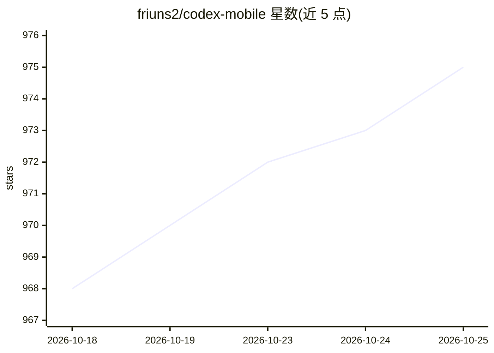

# friuns2/codex-mobile

⭐ 975 · TypeScript · MIT · 推送 2026-09-20 · [GitHub](https://github.com/friuns2/codex-mobile) · [官网](https://friuns2.github.io/codex-mobile/) · 个人维护

**把 Codex 桌面端体验通过浏览器跨平台运行的桥接工具**

codexapp 是一个轻量级桥接层：通过一条 npx 命令启动本地 Web 服务器，把 Codex app-server 的工作流以浏览器 UI 形式暴露出来，支持 Linux、Windows 以及 Android 上的 Termux。默认附带 cloudflared 隧道并输出访问 URL、二维码与密码，可用 --no-tunnel 关闭；支持 LAN 访问、反向代理，可选 Telegram bot 桥接（需配置允许名单的用户 ID）把消息转发进映射的 Codex 线程。还提供按住说话的语音听写、项目 ZIP 导入导出（聊天历史会改写以适配新环境的 CODEX_HOME 与所选 provider/model）。要求 Node.js 18+ 与可用的 Codex app-server 环境。

## 筛选速览

| 维度 | 判定 | 备注 |
|---|---|---|
| AI 角色 | `ai-ecosystem` | LLM/agent 周边工具 |
| 许可风险 | `permissive` | MIT |
| 部署形态 | `library` | 以包/库形式分发 |
| 模型依赖 | — | README 未给出锁定关系 |
| 硬件要求 | — | 无带数字的原话,不猜 |
| 安装摩擦 | `low` | 无编译、无系统依赖或容器化 |
| 成熟度 | — | 结构信号不足 |

## 能力要点

- 一条 npx 命令启动本地 Web 服务器暴露 Codex UI，无需全局安装
- 跨平台：Linux、Windows、Termux on Android，默认附带 cloudflared 隧道与二维码/密码输出
- 可选 Telegram bot 桥接，仅允许白名单用户 ID 使用，支持线程映射与命令集
- 项目 ZIP 导入导出，聊天历史按目标 CODEX_HOME、项目路径与所选 provider/model 改写后可续用

## 适用场景

- 在没有桌面环境的 Linux 工作站或远程服务器上用浏览器使用 Codex
- 在 Android 手机 Termux 里启动服务，从手机浏览器操作 Codex
- 通过 Telegram bot 与映射的 Codex 线程收发消息
- 把 Codex 项目连同聊天历史打包迁移到另一台机器续用

## 场景标签

`编码 Agent` · 领域:编码与开发

## 证据(README 行号)

> L26: **`codexapp`** is a lightweight bridge that gives you a browser-accessible UI for Codex app-server workflows.
> L30: **TL;DR 🧠: Codex app UI, unlocked for Linux, Windows, and Termux-powered Android setups.**
> L127: - 🖥️ Browser-first Codex UI flow on `http://localhost:18923`

## 星数曲线

2026-10-18 968 → 2026-10-25 975（+7）

---
*卡片 v1 · prompt 1.4 · 生成 2026-10-21 · 置信度 high · 依据 README sha `e63f9a5821f8` · [字段定义](../../DATASET.md)*
