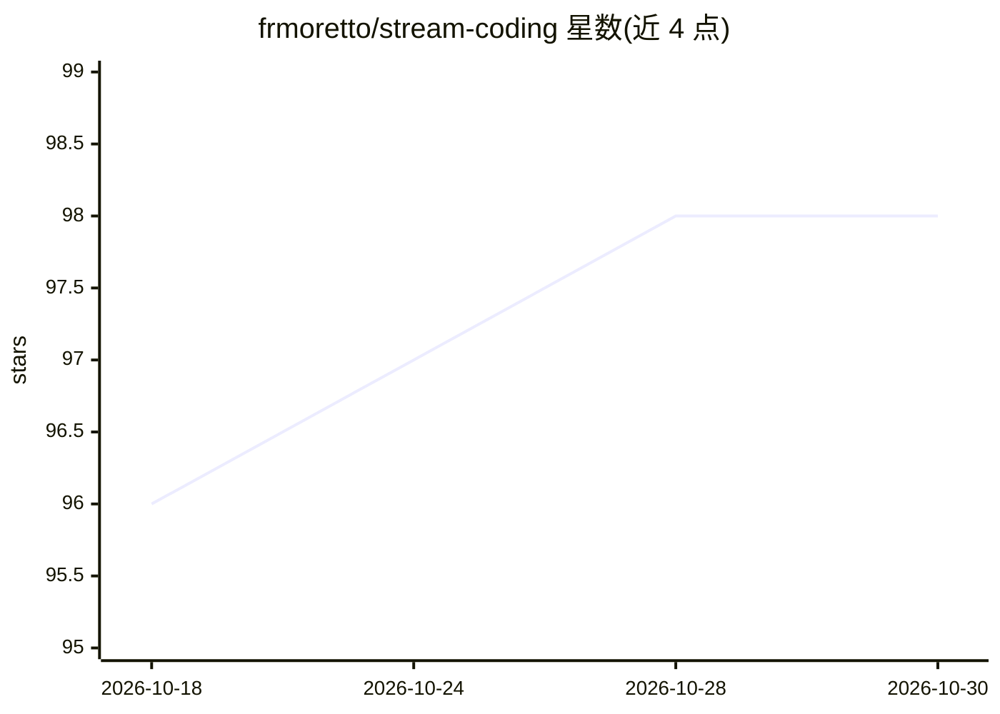

# frmoretto/stream-coding

⭐ 98 · NOASSERTION · 推送 2026-02-26 · [GitHub](https://github.com/frmoretto/stream-coding) · [官网](https://www.stream-coding.com/) · 个人维护

**面向小团队的文档优先 AI 开发方法论（SKILL.md+宣言）**

一套名为 Stream Coding 的方法论与配套文档：主张以 40/40/5/10/5 的精力分配先做战略思考与 AI 可执行规格，再让代码由规格自动流出，并以 Spec Gate 作为阶段门禁。以 Claude 优化的 SKILL.md 文件为核心产物，同时提供复制到 Codex/Copilot/Cursor 等目录的路径，附完整宣言（manifesto）与模板（Strategic Blueprint、ADR、Spec Gate 清单）。作者声明不适用于大型企业（其指向 Kiro、Spec-Kit 等企业工具）。采用 CC BY 4.0 许可。

## 筛选速览

| 维度 | 判定 | 备注 |
|---|---|---|
| AI 角色 | `ai-knowledge` | 知识聚合/清单类 |
| 许可风险 | `none` | NOASSERTION |
| 部署形态 | `None` |  |
| 模型依赖 | — | README 未给出锁定关系 |
| 硬件要求 | — | 无带数字的原话,不猜 |
| 安装摩擦 | `low` | 无编译、无系统依赖或容器化 |
| 成熟度 | — | 结构信号不足 |

## 能力要点

- 提供 Claude 可安装的 SKILL.md（Claude.ai/Claude Code/Claude Projects 三种接入方式）
- 附 Codex、Copilot 目录路径与 Cursor/Windsurf 手动适配说明
- manifesto 目录含 5 章方法论与 5Levels 案例研究
- templates 目录提供 Strategic Blueprint、ADR、Spec Gate Checklist 模板

## 适用场景

- 个人开发者或 1-5 人小团队按规格驱动方式使用 AI 编码
- 把方法论作为 Claude/Codex/Copilot 等 AI 编码工具的上游流程
- 参考模板做架构决策记录与阶段门禁检查

## 场景标签

`教程课程` · 领域:学习与行业

## 证据(README 行号)

> L28: Stream Coding is a documentation-first methodology that makes AI-generated code deterministic.
> L93: The `/manifesto` folder contains the complete methodology:
> L109: The `/templates` folder contains ready-to-use frameworks:

## 星数曲线

2026-10-18 96 → 2026-10-30 98（+2）

---
*卡片 v1 · prompt 1.4 · 生成 2026-10-23 · 置信度 high · 依据 README sha `e0148026e625` · [字段定义](../../DATASET.md)*
