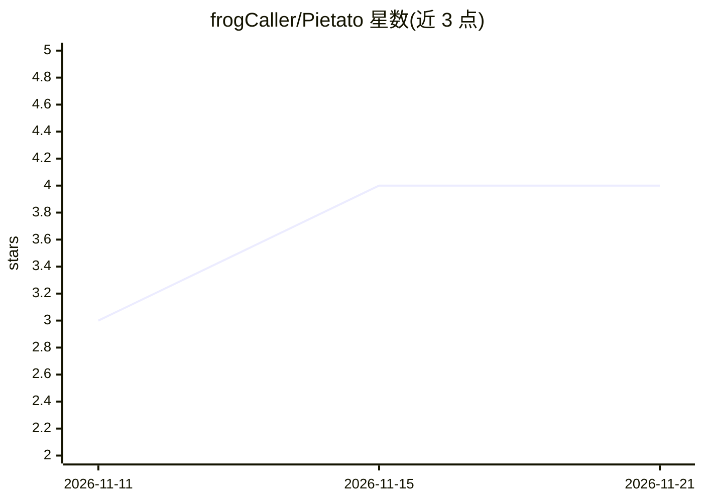

# frogCaller/Pietato

⭐ 4 · Python · MIT · 推送 2026-11-20 · [GitHub](https://github.com/frogCaller/Pietato) · 个人维护

**把树莓派变成集成 AI 机器人的媒体中心系统**

Pietato 将树莓派和游戏手柄组成一体化的媒体中心，提供电视直播、视频、音乐、电台、照片、游戏、摄像头、智能家居控制和 AI 机器人等功能。支持 SD 卡镜像安装（GPi Case 2W/2、HDMI 输出等镜像），或在 Raspberry Pi OS Lite、Ubuntu 24.04/Debian 12-13 上通过 git clone 加 setup.sh 脚本安装，安装时可配置 Home Assistant、Pi-hole、Ollama、Plex、Jellyfin 和 RetroAchievements。首次全量安装需一小时以上。

## 筛选速览

| 维度 | 判定 | 备注 |
|---|---|---|
| AI 角色 | `ai-enhanced` | 去掉 AI 部分产品仍成立 |
| 许可风险 | `permissive` | MIT |
| 部署形态 | `None` |  |
| 模型依赖 | local-ok | 支持本地模型 |
| 硬件要求 | — | 无带数字的原话,不猜 |
| 安装摩擦 | `low` | 无编译、无系统依赖或容器化 |
| 成熟度 | — | 结构信号不足 |

## 能力要点

- 提供树莓派 SD 卡镜像，适配 Zero 2 W/3/4/5/CM4 与 GPi Case
- 交互式 setup.sh 可配置 Ollama、Plex、Jellyfin、Home Assistant、Pi-hole 等
- 支持树莓派 OS Lite、Ubuntu 24.04、Debian 12/13 手动安装
- 内置系统软件更新入口

## 适用场景

- 用 GPi Case 2W 做掌上媒体与复古游戏机
- 接电视/显示器用手柄操作的客厅媒体中心
- 同一台树莓派上集中管理智能家居与广告过滤

## 场景标签

 · 领域:嵌入式/媒体中心

## 证据(README 行号)

> L3: Pietato turns a Raspberry Pi and a game controller into a media center for live TV, videos, music, radio,
> L27: or Custom to pick, and the details for Home Assistant, Pi-hole, Ollama, Plex, Jellyfin and RetroAchievements if
> L44: - The Bot

## 星数曲线

2026-11-11 3 → 2026-11-21 4（+1）

---
*卡片 v1 · prompt 1.4 · 生成 2026-11-21 · 置信度 high · 依据 README sha `7b88ec8c629b` · [字段定义](../../DATASET.md)*
