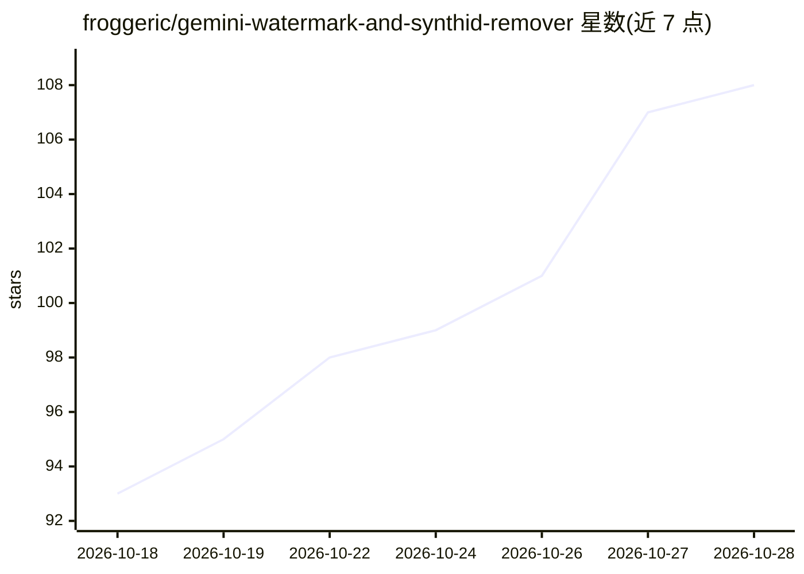

# froggeric/gemini-watermark-and-synthid-remover

⭐ 108 · C++ · MIT · 推送 2026-09-25 · [GitHub](https://github.com/froggeric/gemini-watermark-and-synthid-remover) · 个人维护

**移除 Gemini/Veo/NotebookLM 水印与 SynthID 的跨平台 CLI 工具**

命令行工具 wmr：以精确反向 alpha 混合移除 Gemini/Veo 可见水印，以 MI-GAN 逐场景修复 NotebookLM 水印（macOS 走 Neural Engine/CoreML，Linux/Windows 走 ONNX Runtime CPU），并通过有损 SDXL img2img 再生清除不可见 SynthID 水印；还可无损剥离 C2PA 来源元数据。每个发布包为单文件自包含二进制，捆绑模型与运行库，支持 macOS/Linux/Windows。SynthID 清除为有损操作且无验证 API，regen 首次使用需下载约 4.7–7.3 GB 模型（缓存在 ~/.cache/wmr/）。

## 筛选速览

| 维度 | 判定 | 备注 |
|---|---|---|
| AI 角色 | `ai-native` | 本体是模型或模型工具 |
| 许可风险 | `permissive` | MIT |
| 部署形态 | `desktop` | 安装包/桌面程序 |
| 模型依赖 | — | README 未给出锁定关系 |
| 硬件要求 | — | 无带数字的原话,不猜 |
| 安装摩擦 | `high` | 编译与系统依赖俱全 |
| 成熟度 | — | 结构信号不足 |

## 能力要点

- Gemini/Veo 可见水印精确反向 alpha 混合移除
- SynthID 有损清除：SDXL img2img 再生（CoreML/Metal/CPU 多后端）
- MI-GAN 逐场景修复 NotebookLM 水印（Neural Engine 约 28ms/帧）
- C2PA 来源元数据无损容器级剥离

## 适用场景

- 去除 Gemini 生成图片右下角的钻石水印
- 清除 Veo/NotebookLM 视频中的水印
- 对生成图片执行 SynthID 有损清除（接受画质损失）

## 场景标签

`图像视频处理` · 领域:感知与多模态

## 证据(README 行号)

> L9: `wmr` is a command-line tool that removes **visible** watermarks from images and videos made by Google **Gemini**, *
> L20: |SynthID (invisible)|Gemini images|Lossy SDXL img2img regeneration|Lossy; validated against Google's official manua

## 星数曲线

2026-10-18 93 → 2026-10-28 108（+15）

---
*卡片 v1 · prompt 1.4 · 生成 2026-10-23 · 置信度 high · 依据 README sha `2895dd0a280e` · [字段定义](../../DATASET.md)*
