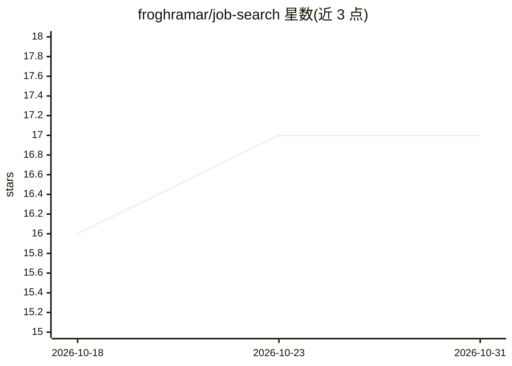

# froghramar/job-search

⭐ 17 · Python · 推送 2025-11-20 · [GitHub](https://github.com/froghramar/job-search) · 个人维护

**用 LangGraph/LangChain 自动化 LinkedIn 求职搜索与申请的 agent**

基于 LangGraph 与 LangChain 构建的求职 agent：以 Claude 为推理模型，通过工具调用实现 LinkedIn 职位搜索（公开爬虫，无需登录）、职位详情获取与 AI 求职信生成；申请提交功能目前为占位实现。以对话方式交互，可经 LangGraph Studio 或 Python SDK 运行。需要 Python 3.10+ 与 Anthropic API key，支持 LangSmith 追踪监控；自动投递、简历优化等功能列为计划项。

## 筛选速览

| 维度 | 判定 | 备注 |
|---|---|---|
| AI 角色 | `ai-native` | 本体是模型或模型工具 |
| 许可风险 | `none` | — |
| 部署形态 | `library` | 以包/库形式分发 |
| 模型依赖 | locked-api |  |
| 硬件要求 | — | 无带数字的原话,不猜 |
| 安装摩擦 | `low` | 无编译、无系统依赖或容器化 |
| 成熟度 | — | 结构信号不足 |

## 能力要点

- 工具调用 agent 架构：搜索/详情/求职信生成工具已可用，投递工具为占位
- 默认公开爬虫抓取真实 LinkedIn 职位，无需认证
- 通过 langgraph dev 启动 LangGraph Studio 提供 Chat/Graph 双界面
- 可更换 LLM 模型与爬虫实现，支持 LangSmith 监控

## 适用场景

- 用自然语言搜索和筛选 LinkedIn 职位
- 为特定职位生成个性化求职信
- 远程/关键词等条件过滤与匹配度分析

## 场景标签

`AI 写作` · 领域:内容生成

## 证据(README 行号)

> L3: An intelligent agentic AI system built with **LangGraph** and **LangChain** to automate LinkedIn job searching and a
> L22: - ✅ AI-powered cover letter generation
> L197: |`search_linkedin_jobs`|Search LinkedIn for real jobs|✅ Live|

## 星数曲线

2026-10-18 16 → 2026-10-31 17（+1）

---
*卡片 v1 · prompt 1.4 · 生成 2026-10-29 · 置信度 mid · 依据 README sha `ec6a5c096587` · [字段定义](../../DATASET.md)*
