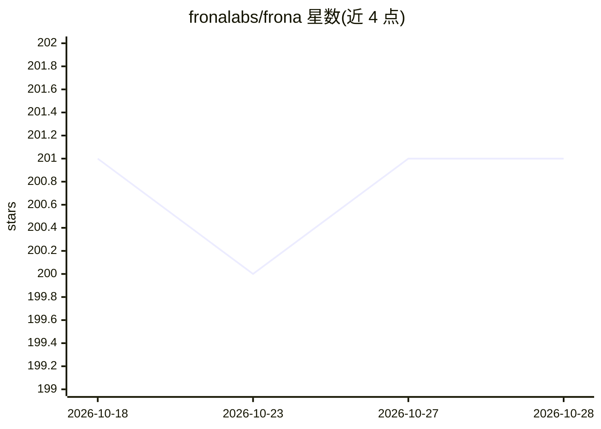

# fronalabs/frona

⭐ 201 · Rust · NOASSERTION · 推送 2026-10-25 · [GitHub](https://github.com/fronalabs/frona) · [官网](https://docs.frona.ai) · 组织维护

**自托管个人 AI 助手平台：创建可自主执行任务的 agent 并通过对话交互**

用 Rust 编写的自托管个人 AI 助手平台，用户创建自主 agent，通过聊天界面下达任务；agent 可浏览网页、在沙箱中执行代码、部署应用、拨打电话、经 Telegram/Slack/Discord 等渠道沟通并相互委派任务。安全机制包括每主体进程级沙箱与统一策略引擎、凭证保险库（1Password/Bitwarden 等）、隔离浏览器会话。支持两种记忆后端（Basic 与本体论支持的 PKM），接入 Anthropic/OpenAI/Gemini/Ollama 等多家 LLM 提供商，以单个 OCI 容器部署，需 Docker/Podman 运行环境。

## 筛选速览

| 维度 | 判定 | 备注 |
|---|---|---|
| AI 角色 | `ai-native` | 本体是模型或模型工具 |
| 许可风险 | `none` | NOASSERTION |
| 部署形态 | `self-host` | docker 或自建部署 |
| 模型依赖 | local-ok | 支持本地模型 |
| 硬件要求 | — | 无带数字的原话,不猜 |
| 安装摩擦 | `low` | 无编译、无系统依赖或容器化 |
| 成熟度 | — | 结构信号不足 |

## 能力要点

- 自主 agent 多步执行任务，可自建工具并相互委派
- 每主体进程级沙箱与统一策略引擎控制工具访问和隔离规则
- 凭证保险库实时审批，支持 1Password/Bitwarden/Vault/KeePass
- 单个 rootless OCI 容器部署（兼容 Docker/Podman）

## 适用场景

- 在自己服务器上运行个人 AI 助手并掌控数据
- 让 agent 自动完成浏览网页、执行代码、构建部署应用等多步任务
- 通过 Telegram/Slack/Discord 等消息渠道随时与同一 agent 对话

## 场景标签

`AI 助手` `多智能体` · 领域:Agent 开发

## 证据(README 行号)

> L12: Frona is a personal AI assistant. You create autonomous agents that browse the web, run code, build applications, m
> L14: You deploy Frona on your own infrastructure and keep full control of your data. The platform is built from the grou

## 星数曲线

2026-10-18 201 → 2026-10-28 201（+0）

---
*卡片 v1 · prompt 1.4 · 生成 2026-10-22 · 置信度 high · 依据 README sha `08b19099cdff` · [字段定义](../../DATASET.md)*
