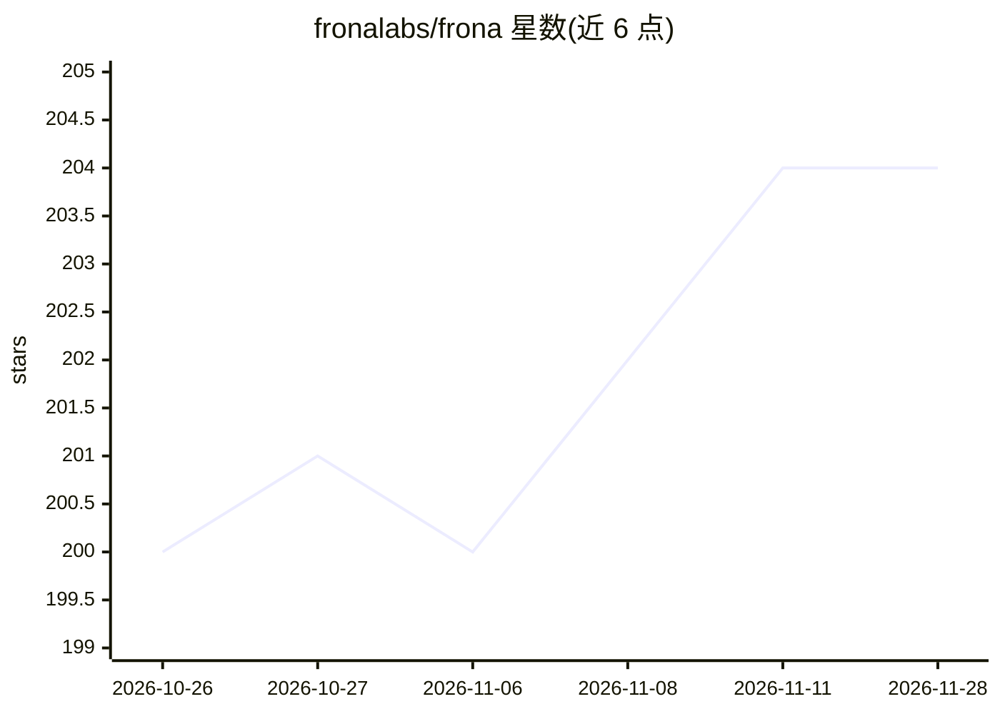

# fronalabs/frona

⭐ 204 · Rust · NOASSERTION · 推送 2026-11-25 · [GitHub](https://github.com/fronalabs/frona) · [官网](https://docs.frona.ai) · 组织维护

**自托管个人 AI 助手平台：自主 agent 配工具并对话协作**

自托管的个人 AI 助手平台：用户创建自主 agent，为其配置工具（浏览器自动化、联网搜索、沙箱代码执行、语音通话、MCP 服务器），通过聊天界面下达任务，agent 可自主多步执行并互相委派。安全机制包括按主体的沙箱进程隔离、统一策略引擎、凭据保险库审批与入站消息的隔离 LLM 分发。引擎以 Rust 编写，前后端打包为单个 rootless OCI 容器部署，内存支持 Basic 与知识图谱 PKM 两种后端。

## 筛选速览

| 维度 | 判定 | 备注 |
|---|---|---|
| AI 角色 | `ai-native` | 本体是模型或模型工具 |
| 许可风险 | `none` | NOASSERTION |
| 部署形态 | `self-host` | docker 或自建部署 |
| 模型依赖 | local-ok | 支持本地模型 |
| 硬件要求 | — | 无带数字的原话,不猜 |
| 安装摩擦 | `low` | 无编译、无系统依赖或容器化 |
| 成熟度 | — | 结构信号不足 |

## 能力要点

- 每主体沙箱隔离与统一策略引擎（工具访问与沙箱规则同一语言）
- 支持 Telegram/Slack/Discord/WhatsApp/Signal 等消息渠道接入同一 agent
- MCP bridge 模式以单一 mcpctl CLI 向 LLM 暴露全部工具以节省 token
- Basic memory 与本体驱动 PKM 知识图谱两种记忆后端

## 适用场景

- 在自己的服务器上部署可控的个人 AI 助手
- 让 agent 自动浏览网页、执行代码并交付应用
- 通过聊天软件随时随地与同一记忆的 agent 对话

## 场景标签

`AI 助手` `浏览器自动化` `聊天机器人` · 领域:效率与自动化

## 证据(README 行号)

> L12: Frona is a personal AI assistant. You create autonomous agents that browse the web, run code, build applications, m
> L50: - **Single-container deployment:** the entire backend (API server, embedded database, scheduler, tool execution) ru

## 星数曲线

2026-10-26 200 → 2026-11-28 204（+4）

---
*卡片 v1 · prompt 1.4 · 生成 2026-11-26 · 置信度 high · 依据 README sha `111b8bf3b1b6` · [字段定义](../../DATASET.md)*
