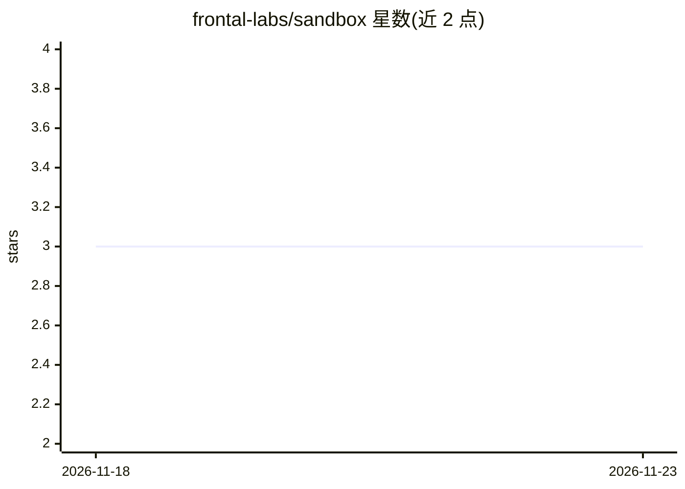

# frontal-labs/sandbox

⭐ 3 · Rust · Apache-2.0 · 推送 2026-11-22 · [GitHub](https://github.com/frontal-labs/sandbox) · 组织维护

**为 AI agent 提供毫秒级沙箱执行环境的基础设施**

Frontal Sandbox 为 AI agent 提供即时的代码执行环境：会话默认运行于 V8/WASM isolate，当命令需要真实 Linux 二进制时升级为 QEMU microVM。采用内容寻址的写时复制虚拟文件系统，支持快照、fork、恢复与可回放 trace，API 覆盖 create/exec/fs/snapshot/fork/destroy，默认拒绝网络并按能力授权。提供 Rust/TypeScript SDK 与 CLI；多数 crate 仍为脚手架/桩，且 README 声明处于 pre-alpha，尚未构成安全边界。

## 筛选速览

| 维度 | 判定 | 备注 |
|---|---|---|
| AI 角色 | `ai-ecosystem` | LLM/agent 周边工具 |
| 许可风险 | `permissive` | Apache-2.0 |
| 部署形态 | `None` |  |
| 模型依赖 | — | README 未给出锁定关系 |
| 硬件要求 | — | 无带数字的原话,不猜 |
| 安装摩擦 | `low` | 无编译、无系统依赖或容器化 |
| 成熟度 | `idea` | |

## 能力要点

- 双层执行：V8 isolate 毫秒级启动，按需升级 QEMU microVM
- 写时复制、内容寻址的虚拟文件系统，多后端共享
- 快照、fork、恢复与可回放 trace 能力
- 能力制访问控制，默认拒绝网络

## 适用场景

- 为 agent 的 shell/文件操作提供隔离执行环境
- 对 agent 每条命令与文件变更做快照与回放审计

## 场景标签

`Agent 框架` · 领域:Agent 开发

## 证据(README 行号)

> L5: **Millisecond sandboxes for AI agents**
> L7: Frontal Sandbox provides instant, low-cost execution environments for AI agents.
> L51: Most crates are early scaffolds or stubs. The server runs session, exec, filesystem, snapshot, fork, and template r

## 星数曲线

2026-11-18 3 → 2026-11-23 3（+0）

---
*卡片 v1 · prompt 1.4 · 生成 2026-11-22 · 置信度 high · 依据 README sha `a5c3351c968c` · [字段定义](../../DATASET.md)*
