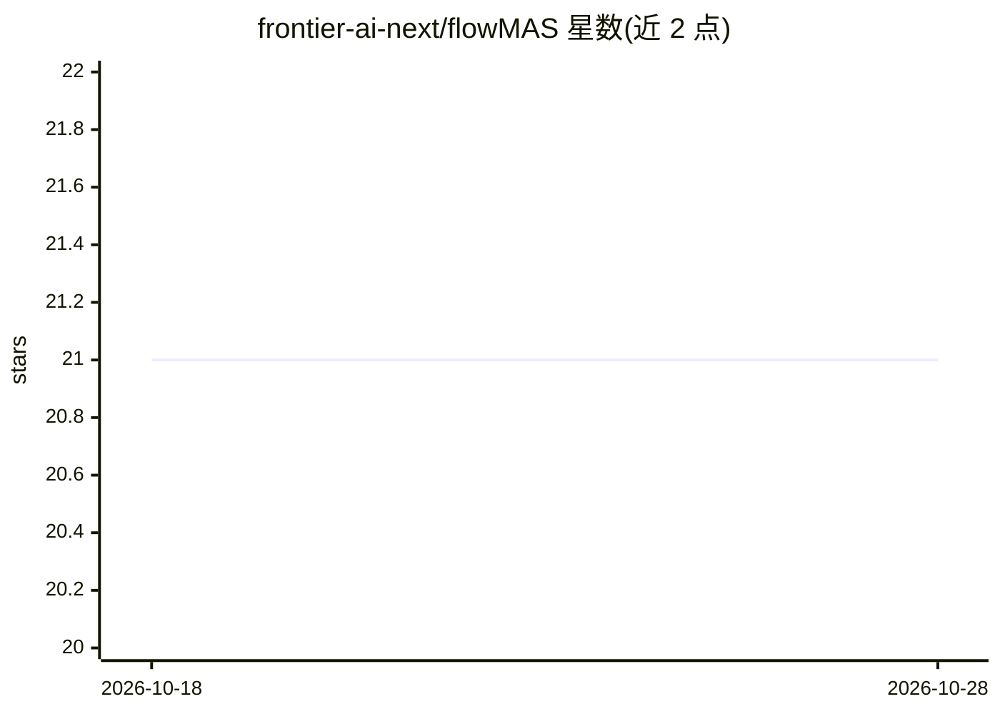

# frontier-ai-next/flowMAS

⭐ 21 · TypeScript · MIT · 推送 2026-09-24 · [GitHub](https://github.com/frontier-ai-next/flowMAS) · [官网](https://gmas.frontierai.ru/) · 组织维护

**多智能体 LLM 工作流的可视化编排工作台与自托管观测平台**

基于 gMAS SDK（以 git submodule 引入）构建的 Web 应用：提供 React 19 + Vite 的图编辑器（agents、边、条件、执行顺序预览）、FastAPI 演示 API 与独立的可观测性服务（运行时间线、tokens、事件、追踪浏览器）。面向需要构建和监控多智能体 LLM 工作流的开发者。支持匿名工作区（cookie 隔离的本地数据目录）、Docker Compose 生产部署、与 Langflow/LangGraph 的基准对比脚本。核心引擎不在此仓库中，须以 --recurse-submodules 克隆。

## 筛选速览

| 维度 | 判定 | 备注 |
|---|---|---|
| AI 角色 | `ai-ecosystem` | LLM/agent 周边工具 |
| 许可风险 | `permissive` | MIT |
| 部署形态 | `self-host` | docker 或自建部署 |
| 模型依赖 | — | README 未给出锁定关系 |
| 硬件要求 | — | 无带数字的原话,不猜 |
| 安装摩擦 | `low` | 无编译、无系统依赖或容器化 |
| 成熟度 | — | 结构信号不足 |

## 能力要点

- 可视化图编辑器：agents、边、条件、执行顺序预览
- 独立自托管观测服务：运行历史、tokens、事件、Trace Explorer
- 匿名工作区按浏览器 cookie 隔离数据，无需登录
- 内置与 Langflow/LangGraph 的基准对比脚本，输出 CSV/PNG/HTML 报告

## 适用场景

- 在浏览器中可视化搭建和调试多智能体 LLM 工作流
- 自托管地监控多智能体运行的延迟、tokens 与事件流
- 对比 gMAS 与 Langflow/LangGraph 在相同场景下的运行指标

## 场景标签

`多智能体` `Agent 框架` `LLM 可观测性` · 领域:Agent 开发

## 证据(README 行号)

> L3: Graph-native web studio, demo API, and self-hosted observability for mutable
> L21: The gMAS SDK core lives in a **separate repository**
> L24: the studio, API, and observability integration; it consumes the core without
> L198: |**core SDK**|`gMAS`|graph engine, agents, runner, tools — the framework|

## 星数曲线

2026-10-18 21 → 2026-10-28 21（+0）

---
*卡片 v1 · prompt 1.4 · 生成 2026-10-28 · 置信度 mid · 依据 README sha `0bd6d059cac1` · [字段定义](../../DATASET.md)*
