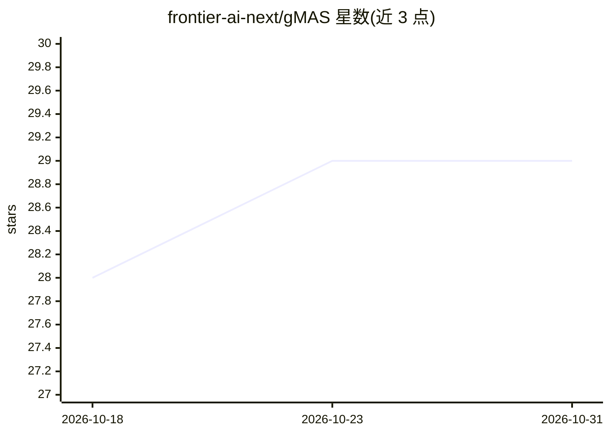

# frontier-ai-next/gMAS

⭐ 29 · Python · MIT · 推送 2026-08-12 · [GitHub](https://github.com/frontier-ai-next/gMAS) · [官网](https://frontier-ai-next.github.io/gMAS/) · 组织维护

**给开发者的图结构多智能体 LLM 系统构建与运行框架**

gMAS 是一个开源 Python 框架，用图（RoleGraph）建模多智能体 LLM 系统：节点承载角色与任务，边传递工作与上下文，运行器调度模型与工具调用。支持同步/异步/流式执行、条件路由、运行中拓扑修改、token/时间预算、记忆、回调与 JSONL 追踪等可观测性，并可导出邻接张量与 PyTorch Geometric 数据用于 GNN 路由与剪枝研究。模型接入采用通用 Callable 接口，兼容 OpenAI 端点与本地模型。要求 Python 3.12/3.13，自述为早期版本、部分高级 API 可能变化。

## 筛选速览

| 维度 | 判定 | 备注 |
|---|---|---|
| AI 角色 | `ai-ecosystem` | LLM/agent 周边工具 |
| 许可风险 | `permissive` | MIT |
| 部署形态 | `library` | 以包/库形式分发 |
| 模型依赖 | — | README 未给出锁定关系 |
| 硬件要求 | — | 无带数字的原话,不猜 |
| 安装摩擦 | `low` | 无编译、无系统依赖或容器化 |
| 成熟度 | `idea` | |

## 能力要点

- RoleGraph 存储团队结构，调度器从图推导执行顺序与并行分组
- 运行中拓扑修改：跳过/增删边/恢复链/更换最终应答者/重建计划
- 预算、重试、回退、循环上限等策略集中在 RunnerConfig
- 图可导出为张量与 PyTorch Geometric Data，支持 GNN 路由与剪枝实验

## 适用场景

- 构建带显式依赖与并行分支的多智能体 LLM 工作流
- 在执行中根据中间结果调整剩余计划
- 集中管控 token/时间/迭代预算并收集可复现 traces
- 研究学习式路由与图剪枝策略

## 场景标签

`多智能体` `Agent 框架` · 领域:Agent 开发

## 证据(README 行号)

> L18: gMAS is an open-source Python framework for building and running graph-based
> L50: |Models|A simple callable interface, OpenAI-compatible endpoints, and per-agent caller selection|
> L181: caller to each agent. Callers may use hosted APIs, OpenAI-compatible gateways,

## 星数曲线

2026-10-18 28 → 2026-10-31 29（+1）

---
*卡片 v1 · prompt 1.4 · 生成 2026-10-26 · 置信度 high · 依据 README sha `ce6e980fa521` · [字段定义](../../DATASET.md)*
