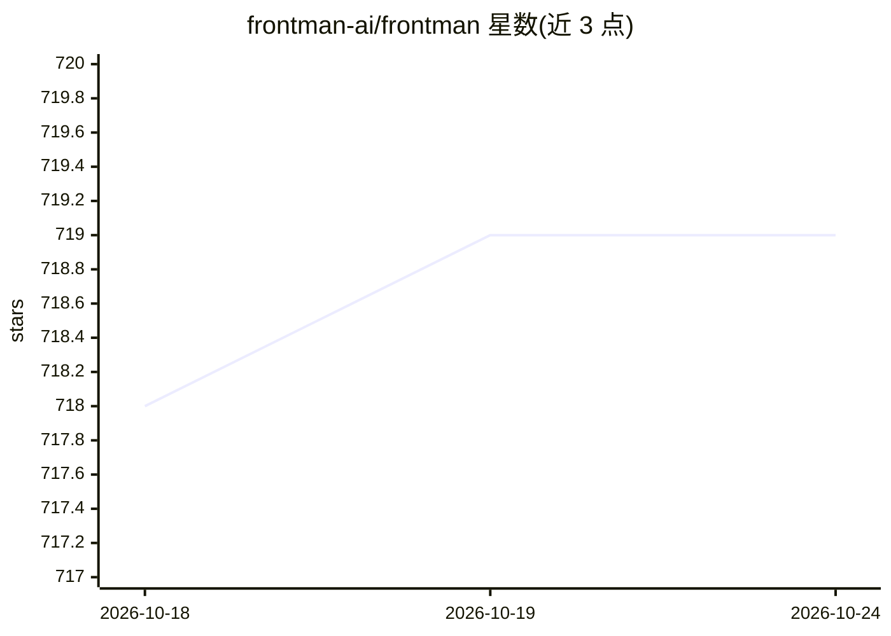

# frontman-ai/frontman

⭐ 719 · ReScript · NOASSERTION · 推送 2026-10-24 · [GitHub](https://github.com/frontman-ai/frontman) · [官网](https://frontman.sh) · 组织维护

**浏览器内 AI 编码 agent：点击页面元素用自然语言改前端源码**

开源 AI 编码 agent，以框架中间件形式接入 Next.js、Astro、Vite（React/Vue/Svelte），将本地 dev server 变为 MCP server，读取实时 DOM、组件树、computed CSS、路由、source maps 与服务器日志。用户在浏览器中点击元素并用自然语言描述修改，agent 编辑对应源文件并热重载，产出可经评审流程的 diff。BYOK 模式接入 OpenAI、Anthropic、OpenRouter 等任意 LLM 提供商，试用 5 次免卡。框架集成仅限开发模式，生产构建会移除 Frontman。许可为拆分模式：库 Apache 2.0、服务端 AGPL-3.0。

## 筛选速览

| 维度 | 判定 | 备注 |
|---|---|---|
| AI 角色 | `ai-native` | 本体是模型或模型工具 |
| 许可风险 | `none` | NOASSERTION |
| 部署形态 | `library` | 以包/库形式分发 |
| 模型依赖 | locked-api |  |
| 硬件要求 | — | 无带数字的原话,不猜 |
| 安装摩擦 | `low` | 无编译、无系统依赖或容器化 |
| 成熟度 | — | 结构信号不足 |

## 能力要点

- 点击运行中应用的元素即可定位并编辑对应源文件，热重载生效
- 框架中间件将本地 dev server 变为 MCP server，提供 DOM/computed CSS/组件树/服务器日志上下文
- 支持 Next.js（App/Pages Router）、Astro 5-7、Vite（React/Vue/Svelte/SvelteKit）
- BYOK 接入 OpenAI、Anthropic、OpenRouter、Fireworks、NVIDIA、Google、xAI 等 LLM 提供商

## 适用场景

- 产品经理和设计师在浏览器里直接修复文案、间距、配色等前端细节
- 前端开发者借助渲染态上下文（computed CSS、组件树）做精确 UI 修改
- 团队在浏览器内完成小改动后通过常规评审流程交付 diff

## 场景标签

`编码 Agent` · 领域:编码与开发

## 证据(README 行号)

> L12: Frontman is an open-source AI coding agent that lives in your browser. Click any element in your running app, descr
> L73: The framework integration turns your local dev server into an MCP server that the AI agent queries for both client-

## 星数曲线

2026-10-18 718 → 2026-10-24 719（+1）

---
*卡片 v1 · prompt 1.4 · 生成 2026-10-21 · 置信度 high · 依据 README sha `ac727475037d` · [字段定义](../../DATASET.md)*
