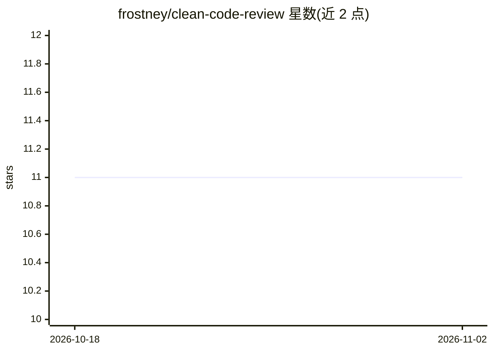

# frostney/clean-code-review

⭐ 11 · TypeScript · MIT · 推送 2026-10-13 · [GitHub](https://github.com/frostney/clean-code-review) · [官网](https://clean-code-review.vercel.app) · 个人维护

**按 Clean Code 标准评审 PR 代码文件的 AI 代码评审应用**

面向公开 GitHub PR、diff 或单文件的代码评审应用：Jev（TypeSafe 的评估模型）对每个代码文件回答一套取自 Robert C. Martin《Clean Code》的问题，Luna 根据答案流式生成评审文本。基于 eve 构建，部署为单个 Next.js 项目，提供浏览器界面、CLI 与无状态 MCP 接口（支持 Claude 等客户端接入）。限制：仅公开仓库，每次评审最多 24 个代码文件、单文件 64,000 字符，配置/样式/数据文件跳过；共享部署设有预算与速率限制，一次 24 文件评审成本约 $0.02。

## 筛选速览

| 维度 | 判定 | 备注 |
|---|---|---|
| AI 角色 | `ai-native` | 本体是模型或模型工具 |
| 许可风险 | `permissive` | MIT |
| 部署形态 | `self-host` | docker 或自建部署 |
| 模型依赖 | — | README 未给出锁定关系 |
| 硬件要求 | — | 无带数字的原话,不猜 |
| 安装摩擦 | `low` | 无编译、无系统依赖或容器化 |
| 成熟度 | — | 结构信号不足 |

## 能力要点

- 每个文件按 Clean Code 问题集由 Jev 给出概率与分数，Luna 汇总生成评审
- 浏览器/终端/MCP 三种使用方式，评审结果有永久链接
- 编辑文件后仅重新评审该文件；提问集合按文件类型（测试/diff）区分
- 多层预算与限流：Vercel Firewall、每周 $15 AI Gateway 预算、每会话花费上限

## 适用场景

- 提交 PR 前获得按 Clean Code 标准的自动化评审意见
- 粘贴私有代码或 git diff 输出做评审（不经浏览器）
- 让 Claude 等 agent 通过 MCP 工具调用代码评审
- 修改代码后快速重新评审单个文件

## 场景标签

`代码审查` · 领域:编码与开发

## 证据(README 行号)

> L5: Point it at a public GitHub pull request, a diff or a file. Jev, TypeSafe's
> L8: those answers. It runs on eve and deploys as one Next.js
> L93: Jev is an AI SDK *evaluation* model, not a chat model, so

## 星数曲线

2026-10-18 11 → 2026-11-02 11（+0）

---
*卡片 v1 · prompt 1.4 · 生成 2026-11-02 · 置信度 mid · 依据 README sha `f0d3ce1f0d24` · [字段定义](../../DATASET.md)*
