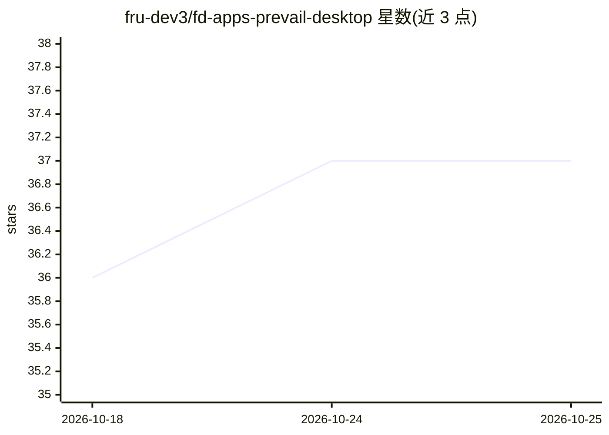

# fru-dev3/fd-apps-prevail-desktop

⭐ 37 · TypeScript · GPL-3.0 · 推送 2026-10-11 · [GitHub](https://github.com/fru-dev3/fd-apps-prevail-desktop) · [官网](https://prevail.sh) · 个人维护

**macOS 本地优先的个人 AI 生活操作系统桌面应用**

面向个人用户的本地优先桌面应用：在用户机器上的 markdown vault 中，按财富、健康、税务、职业等生活领域运行 AI 对话，每领域基于自身状态与历史作答。支持接入已安装的 CLI（Claude/Codex/Antigravity/Ollama）或经 OpenRouter 网关自带模型（200+，OpenAI 兼容 key 一把）。含 Council 多模型并行讨论、意图账本与自蒸馏记忆、Telegram 网关、MCP、远程 WebUI 与本地语音转录（whisper-cpp/hear）。macOS 13+（Apple Silicon）提供签名 DMG，Windows x64 提供安装包；语音等功能需额外安装 whisper-cpp、ffmpeg、cloudflared 等可选组件。GPL-3.0-only。

## 筛选速览

| 维度 | 判定 | 备注 |
|---|---|---|
| AI 角色 | `ai-native` | 本体是模型或模型工具 |
| 许可风险 | `viral` | GPL-3.0 |
| 部署形态 | `desktop` | 安装包/桌面程序 |
| 模型依赖 | local-ok | 支持本地模型 |
| 硬件要求 | — | 无带数字的原话,不猜 |
| 安装摩擦 | `medium` | 含编译或系统依赖之一 |
| 成熟度 | — | 结构信号不足 |

## 能力要点

- 按生活领域（财富/健康/税务/职业等）运行 AI，基于本地 markdown vault 的领域状态作答
- 多模型接入：本地 CLI（Claude/Codex/Antigravity/Ollama）或 OpenRouter 网关 200+ 模型，可逐轮切换
- Council 模式：一个问题并行发给多模型，由 chair 模型综合结论
- 意图账本→按领域蒸馏 _memory.md 的自学习记忆
- 本地语音转录（whisper-cpp 或 Apple hear），转录在 Mac 上运行

## 适用场景

- 在本地管理财富、健康、税务等个人领域并与之对话
- 同时使用多个模型并获得综合结论
- 通过手机 WebUI 语音操控 Mac 上的个人 AI

## 场景标签

`AI 助手` `语音识别` · 领域:对话与助手

## 证据(README 行号)

> L7: A local-first **life-OS** for macOS. A native cockpit that runs AI per
> L8: life-domain (**wealth, health, tax, career**), grounded in a markdown vault on
> L9: *your* machine. Any model. No terminal. Nothing leaves unless you say so.

## 星数曲线

2026-10-18 36 → 2026-10-25 37（+1）

---
*卡片 v1 · prompt 1.4 · 生成 2026-10-25 · 置信度 mid · 依据 README sha `f801bb6ab81e` · [字段定义](../../DATASET.md)*
