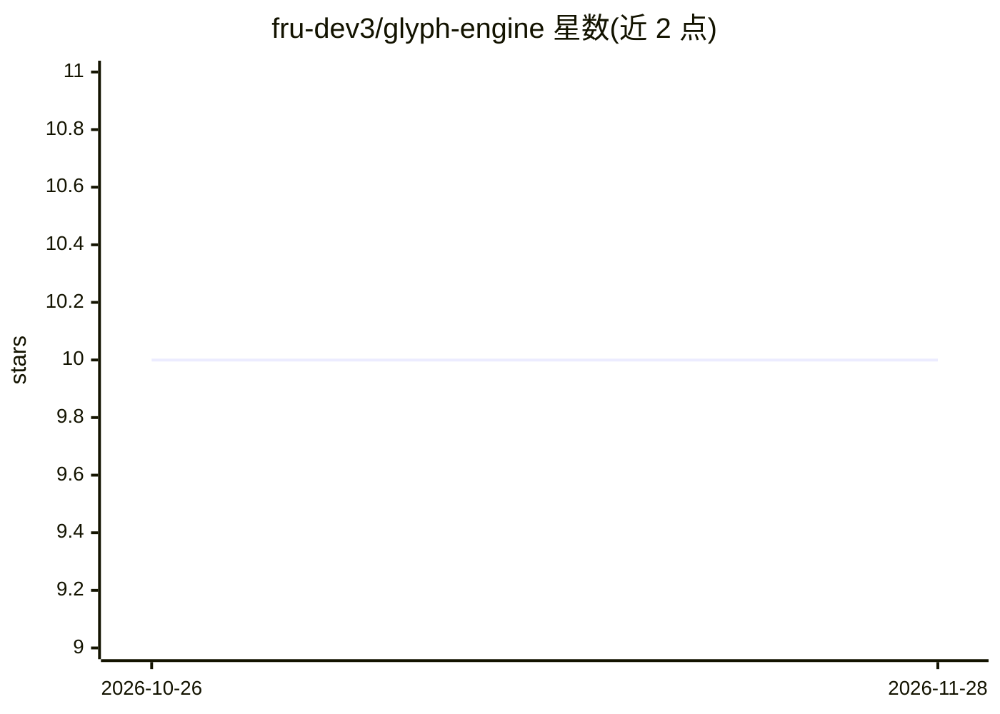

# fru-dev3/glyph-engine

⭐ 10 · TypeScript · GPL-3.0 · 推送 2026-11-27 · [GitHub](https://github.com/fru-dev3/glyph-engine) · [官网](https://glyph.fru.dev/studio) · 个人维护

**终端驾驶舱：把一个问题并行问多个 AI CLI 并汇总裁决**

单二进制终端应用（命令仍为 prevail），将用户 vault 中 markdown 域文件夹内的问题并行分发给已登录的 claude、codex、gemini、本地 Ollama 等 CLI，由一个 chair 模型汇总为单一裁决，并以独立面板呈现各模型分歧。提供 20+ 生活域工作区、framework/lens 每域配置、Telegram 桥接、cron 定时简报、OAuth/API/MCP 等连接器与自治代理任务运行。95 MB 单二进制，bun-only，macOS/Linux，Windows 仅 WSL；无需 Docker 与强制 API key。

## 筛选速览

| 维度 | 判定 | 备注 |
|---|---|---|
| AI 角色 | `ai-ecosystem` | LLM/agent 周边工具 |
| 许可风险 | `viral` | GPL-3.0 |
| 部署形态 | `None` |  |
| 模型依赖 | local-ok | 支持本地模型 |
| 硬件要求 | — | 无带数字的原话,不猜 |
| 安装摩擦 | `low` | 无编译、无系统依赖或容器化 |
| 成熟度 | — | 结构信号不足 |

## 能力要点

- 同一问题并行发给 4 个 AI CLI，chair 模型合成单一裁决并单独呈现分歧
- 复用用户已登录的 CLI 凭据、MCP 服务器与技能，无需管理 API key；本地 Ollama 自动检测
- 域=纯 markdown 文件夹，无数据库；每轮对话自动写入决策日志
- Telegram 桥接、cron 定时简报与自治代理 harness 驱动（hermes/pi/opencode/openclaw）

## 适用场景

- 把财富/健康/职业等问题同时问多个 AI 模型并比较分歧
- 在手机上通过 Telegram 使用同一套 council 引擎
- 用 cron 定时向指定生活域推送每日简报

## 场景标签

`AI 助手` `多智能体` · 领域:Agent 开发

## 证据(README 行号)

> L6:  Ask Claude, Codex, Antigravity (Google's `agy`), and your local Ollama the same question in parallel. Let the counc
> L51: |**● Uses CLIs you already pay for**|Spawns `claude`, `codex`, `gemini`, inherits every login, MCP server, and skil
> L69: - **Council** is a single toggle on the right. `● ON` fans every question to every available CLI; `◆ OFF` uses just

## 星数曲线

2026-10-26 10 → 2026-11-28 10（+0）

---
*卡片 v1 · prompt 1.4 · 生成 2026-11-19 · 置信度 high · 依据 README sha `94a161be4d45` · [字段定义](../../DATASET.md)*
