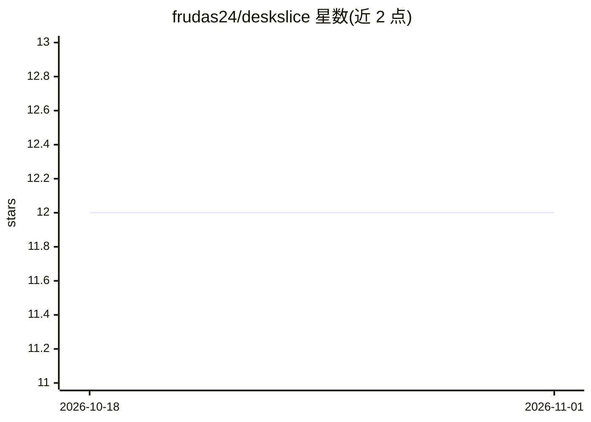

# frudas24/deskslice

⭐ 12 · Go · NOASSERTION · 推送 2026-10-27 · [GitHub](https://github.com/frudas24/deskslice) · 个人维护

**手机局域网远程控制 VS Code 内 Codex 面板的工具**

Go 编写的 Windows 主机屏幕远程控制服务：通过 ffmpeg 采集（d3d11grab/gdigrab）以 WebRTC H264 低延迟流或 MJPEG 预览两种模式，将 VS Code 中 Codex 面板画面推送到手机浏览器，并注入触摸映射的鼠标/键盘输入。校准为手动划定插件/聊天/滚动矩形，不做 OCR 或元素检测。面向可信局域网/VPN 使用，密码认证较简单，同一时刻仅支持一个观看端。需 Go 1.25+ 从源码构建，ffmpeg 为必需依赖。

## 筛选速览

| 维度 | 判定 | 备注 |
|---|---|---|
| AI 角色 | `ai-enhanced` | 去掉 AI 部分产品仍成立 |
| 许可风险 | `none` | NOASSERTION |
| 部署形态 | `desktop` | 安装包/桌面程序 |
| 模型依赖 | — | README 未给出锁定关系 |
| 硬件要求 | — | 无带数字的原话,不猜 |
| 安装摩擦 | `medium` | 含编译或系统依赖之一 |
| 成熟度 | `idea` | |

## 能力要点

- WebRTC H264 低延迟流 + MJPEG 回退两种模式
- 触摸输入映射（点击、滚动、打字）与手动矩形校准
- 运行模式将光标限制在校准的插件矩形内以防误点
- 运行时可通过 POST /api/config 调节 MJPEG 帧率与质量

## 适用场景

- 离开桌面后用手机继续操作 VS Code 里的 Codex 面板
- 需要变换姿势工作时远程查看和输入 AI 编程对话
- 在可信局域网/VPN 内做低延迟的指定区域屏幕操控

## 场景标签

 · 领域:开发工具/远程桌面

## 证据(README 行号)

> L3: Remote control for the real Codex panel inside VS Code, designed for LAN use
> L9: - Control the **real Codex panel** on your Windows host from your phone over LAN (video + mouse/keyboard), without r

## 星数曲线

2026-10-18 12 → 2026-11-01 12（+0）

---
*卡片 v1 · prompt 1.4 · 生成 2026-11-01 · 置信度 mid · 依据 README sha `1f691f613781` · [字段定义](../../DATASET.md)*
