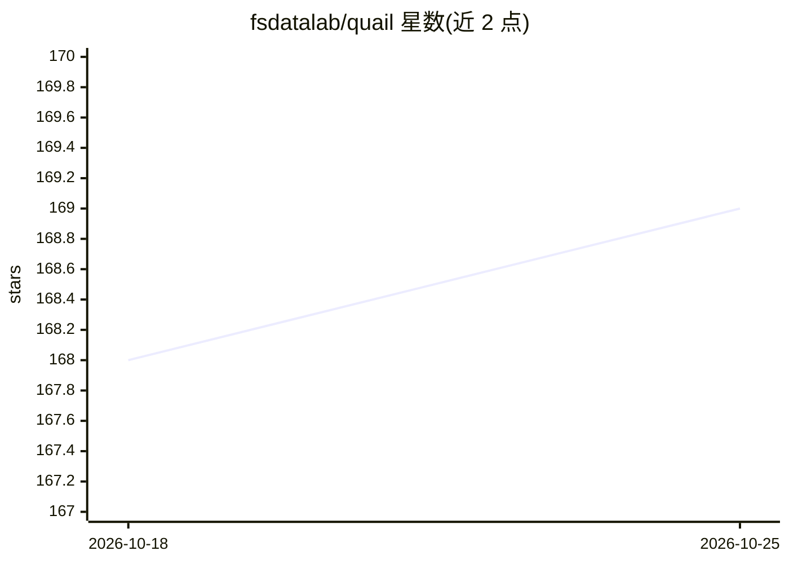

# fsdatalab/quail

⭐ 169 · Python · MIT · 推送 2026-10-24 · [GitHub](https://github.com/fsdatalab/quail) · [官网](https://fsdatalab.github.io/quail) · 组织维护

**面向开发者的 AI-SQL 执行引擎，SQL 中嵌入自然语言指令**

由 CMU Full Stack Data Lab 开发的开源执行引擎（QUery-Aware Inference Layer）：在 SQL 查询中用自然语言写指令（如 AI.IF、AI.SCORE、AI.CLASSIFY、AI.EXTRACT），由语言模型对每行求值，支持过滤、连接、分类与抽取；兼容 Snowflake AI_FILTER 与 BigQuery AI.IF 两种方言及 Python builder API。以 pip 包 quail-engine 提供，另可安装 server 扩展在 GPU 机器上运行查询并断线续跑。要求 Python 3.12 与 CUDA GPU，支持 1/2/4/8 GPU，README 列出 Qwen3 等模型在 H100 等设备上的组合。

## 筛选速览

| 维度 | 判定 | 备注 |
|---|---|---|
| AI 角色 | `ai-ecosystem` | LLM/agent 周边工具 |
| 许可风险 | `permissive` | MIT |
| 部署形态 | `library` | 以包/库形式分发 |
| 模型依赖 | — | README 未给出锁定关系 |
| 硬件要求 | — | 无带数字的原话,不猜 |
| 安装摩擦 | `medium` | 含编译或系统依赖之一 |
| 成熟度 | — | 结构信号不足 |

## 能力要点

- SQL 内嵌自然语言指令由 LLM 逐行求值（AI.IF/AI.SCORE/AI.CLASSIFY/AI.EXTRACT）
- 兼容 Snowflake AI_FILTER 与 BigQuery AI.IF 方言，另提供 Python builder API
- Quail Server 在 GPU 机器上运行查询，支持断线重连（submit/get_run）
- 支持 1/2/4/8 GPU 并行，列出 Qwen3 等多模型在 H100/RTX PRO 6000 上的组合

## 适用场景

- 在 SQL 工作流中直接做评论筛选、分类、打分等 LLM 判断
- 把查询卸载到 GPU 服务器异步执行并断线续跑
- 用熟悉的 BigQuery/Snowflake AI-SQL 方言迁移查询到本地推理

## 场景标签

`数据分析` · 领域:效率与自动化

## 证据(README 行号)

> L3: Quail (QUery-Aware Inference Layer) is an open-source execution engine
> L7: With AI-SQL, you write instructions in natural language inside your SQL
> L63: You can use filters and joins evaluated by a language model,

## 星数曲线

2026-10-18 168 → 2026-10-25 169（+1）

---
*卡片 v1 · prompt 1.4 · 生成 2026-10-23 · 置信度 high · 依据 README sha `d6956c2d77ef` · [字段定义](../../DATASET.md)*
