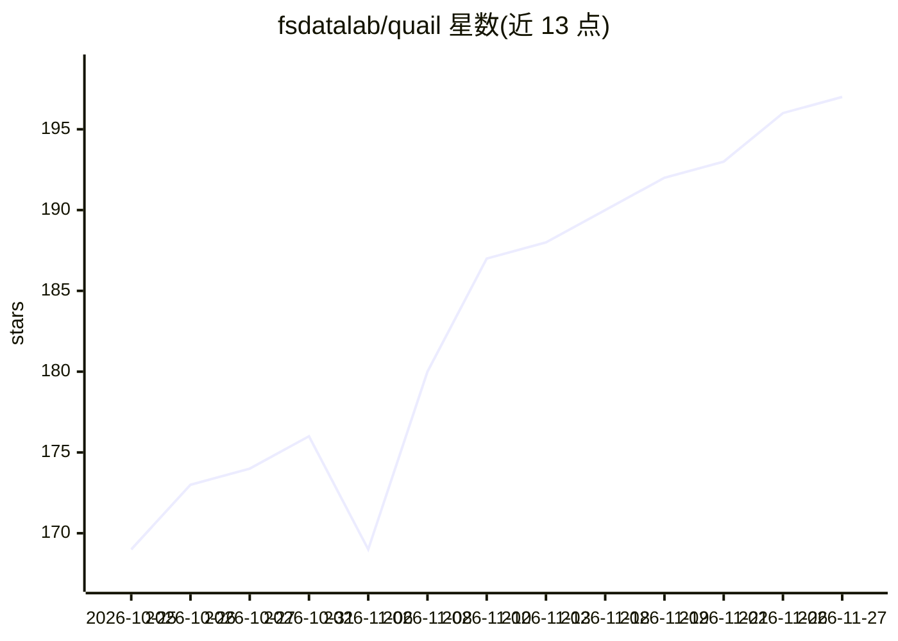

# fsdatalab/quail

⭐ 197 · Python · MIT · 推送 2026-11-25 · [GitHub](https://github.com/fsdatalab/quail) · [官网](https://fsdatalab.github.io/quail) · 组织维护

**面向数据分析的 SQL AI 函数推理引擎**

Quail 是 Apache DataFusion 的扩展，在 SQL 中运行 AI 函数：将行文本发送给模型并返回模型答案（如 AI.IF 过滤、AI.CLASSIFY 标注、AI.EXTRACT 抽取）。解析、计划与执行由 DataFusion 完成，模型侧支持 Qwen3 系列等，可指定 GPU 运行，也提供 Quail Server 在远程 GPU 上执行查询并支持客户端断开后继续运行。提供 Python 包与 Rust crate 两种接入方式。

## 筛选速览

| 维度 | 判定 | 备注 |
|---|---|---|
| AI 角色 | `ai-native` | 本体是模型或模型工具 |
| 许可风险 | `permissive` | MIT |
| 部署形态 | `library` | 以包/库形式分发 |
| 模型依赖 | — | README 未给出锁定关系 |
| 硬件要求 | — | 无带数字的原话,不猜 |
| 安装摩擦 | `medium` | 含编译或系统依赖之一 |
| 成熟度 | — | 结构信号不足 |

## 能力要点

- 在 SQL 中提供 AI.IF/AI.SCORE/AI.CLASSIFY/AI.EXTRACT 等 7 个 AI 函数
- 基于 Apache DataFusion，可从 Python（uv/pip 包）或 Rust crate 接入
- Quail Server 支持远程 GPU 执行，客户端断开后查询继续运行
- 同一文档只读取一次即可服务多个 AI 函数调用

## 适用场景

- 用 SQL 过滤和标注大规模文本数据（如评论分类）
- 对非结构化文本做字段抽取
- 在自有 GPU 或远程 GPU 机器上运行带模型推理的查询

## 场景标签

`数据分析` `推理引擎` · 领域:效率与自动化

## 证据(README 行号)

> L13: Quail runs SQL with AI functions. An AI function, such as
> L14: `AI.IF`, sends a row's text to a model and returns the model's answer.
> L16: we use DataFusion to parse, plan, and run the rest of the SQL.

## 星数曲线

2026-10-25 169 → 2026-11-27 197（+28）

---
*卡片 v1 · prompt 1.4 · 生成 2026-11-25 · 置信度 high · 依据 README sha `4e90571d9faf` · [字段定义](../../DATASET.md)*
