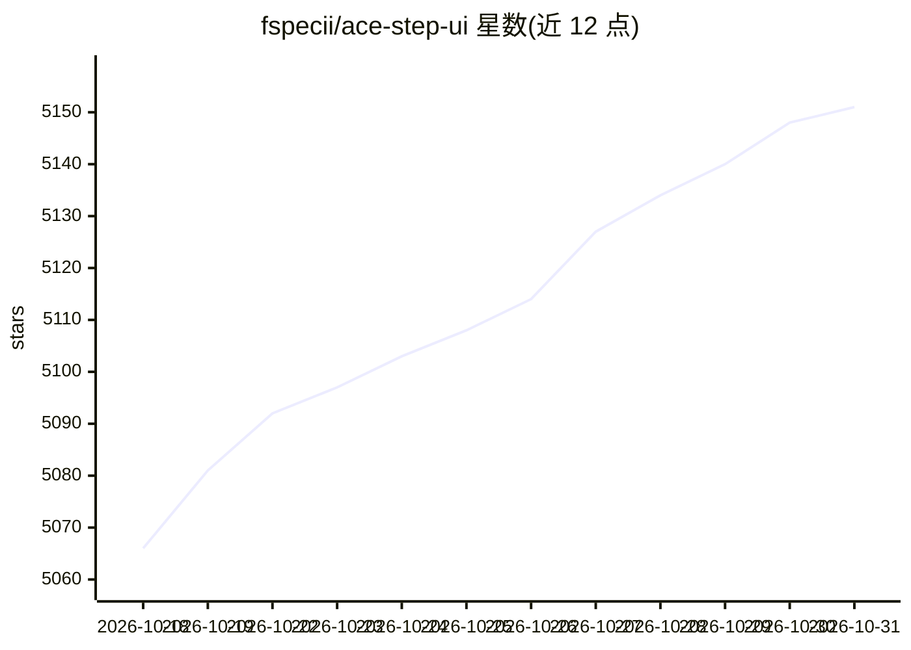

# fspecii/ace-step-ui

⭐ 5,151 · JavaScript · 推送 2026-06-27 · [GitHub](https://github.com/fspecii/ace-step-ui) · [官网](https://webdesignstudio.london/) · 个人维护

**本地运行的 ACE-Step 1.5 AI 音乐生成模型的 Web 界面**

为开源音乐生成模型 ACE-Step 1.5 提供的 React/TypeScript 前端与 Express 后端，通过 Gradio API 调用模型在本地 GPU 生成带人声的完整歌曲。功能覆盖歌词编辑、风格标签、AI Enhance 标签扩写、Thinking Mode 推理生成、批量生成、参考音频、局部重绘，以及曲库管理、Demucs 分离人声/鼓/贝斯、AudioMass 音频编辑、音乐视频生成等内置工具。支持 Windows/Linux/macOS，提供 Pinokio 一键安装与 Windows 便携包；要求 Node.js 18+、Python 3.10+、NVIDIA GPU 4GB+ 显存（LLM 功能需 12GB+）、FFmpeg。

## 筛选速览

| 维度 | 判定 | 备注 |
|---|---|---|
| AI 角色 | `ai-native` | 本体是模型或模型工具 |
| 许可风险 | `none` | — |
| 部署形态 | `library` | 以包/库形式分发 |
| 模型依赖 | local-ok | 支持本地模型 |
| 硬件要求 | `gpu-8g` | |
| 安装摩擦 | `medium` | 含编译或系统依赖之一 |
| 成熟度 | — | 结构信号不足 |

## 能力要点

- 调用本地 ACE-Step 1.5 生成 4+ 分钟带人声的完整歌曲
- AI Enhance 将风格标签扩写为含 BPM/调性的详细描述，LLM 可运行于 CPU
- 内置 Demucs 音轨分离、音频编辑、音乐视频生成、程序化封面生成
- 支持 Pinokio 一键安装、Windows 便携包与 LAN 内多设备访问

## 适用场景

- 在本地免费生成带歌词的完整歌曲而不依赖云端订阅
- 用风格标签、参考音频和种子控制精细化调整生成结果
- 在曲库中管理、播放生成的音乐并做人声分离与剪辑

## 场景标签

`视频生成` · 领域:内容生成

## 证据(README 行号)

> L6:  Seamless integration with ACE-Step 1.5 - The Open Source AI Music Generation Model
> L117: |**AI Engine**|ACE-Step 1.5 (Gradio API)|
> L40:  Generate professional AI music with a Spotify-like interface - 100% free and local

## 星数曲线

2026-10-18 5,066 → 2026-10-31 5,151（+85）

---
*卡片 v1 · prompt 1.4 · 生成 2026-10-20 · 置信度 high · 依据 README sha `2ecfd495f3dc` · [字段定义](../../DATASET.md)*
