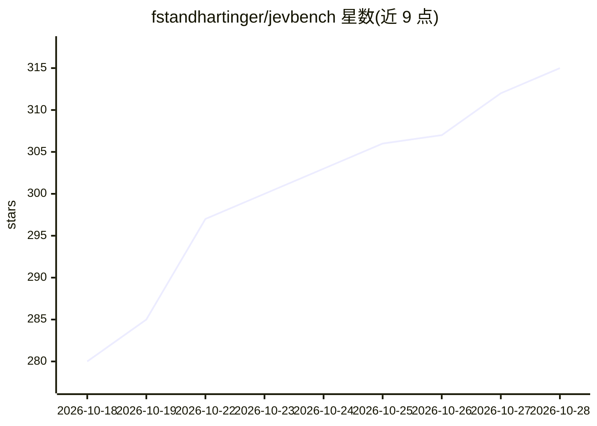

# fstandhartinger/jevbench

⭐ 315 · Python · MIT · 推送 2026-10-15 · [GitHub](https://github.com/fstandhartinger/jevbench) · [官网](https://benchmarkheaven.com/jev-models) · 组织维护

**AI 决策模型评测基准与排行榜：测准确率、校准、延迟、成本**

Benchmark Heaven 维护的 AI 决策模型基准，评测 Jev（TypeSafe AI 的决策模型）及 Jev-compatible 系统。四个测量轴：机会校正的 Intelligence、概率校准（Calibration）、Speed、Cost，按算术/加权几何均值得出 Capability 与 Composite Score，设成本与延迟上限。任务集含 534 个决策（硬档 220 个，其中 109 个保留不公开），冻结并哈希后测试；评分代码与结果 JSON/CSV 工件公开，在线榜单托管于 benchmarkheaven.com。声明的限制：任务覆盖有限、密封输入阻碍完整独立复测、延迟与成本为建模值而非实测账单。

## 筛选速览

| 维度 | 判定 | 备注 |
|---|---|---|
| AI 角色 | `ai-ecosystem` | LLM/agent 周边工具 |
| 许可风险 | `permissive` | MIT |
| 部署形态 | `None` |  |
| 模型依赖 | — | README 未给出锁定关系 |
| 硬件要求 | — | 无带数字的原话,不猜 |
| 安装摩擦 | `low` | 无编译、无系统依赖或容器化 |
| 成熟度 | — | 结构信号不足 |

## 能力要点

- 四轴评分：机会校正 Intelligence、Calibration、Speed、Cost
- 任务集 534 个决策，冻结并哈希后才运行被测系统
- 结果以 JSON/CSV 工件与 source_sha256 发布，缺失测量记 null 不记零
- 保留历史版本评分定义，跨版本分数不可直接比较

## 适用场景

- 对比候选决策模型在准确率、校准、延迟、成本上的表现
- 按主题（数学/编程/法律/金融等）查看准确率聚合
- 了解各模型每千次决策的成本与延迟量级

## 场景标签

`模型评测` · 领域:评测与运维

## 证据(README 行号)

> L9: JevBench by Benchmark Heaven is a benchmark for AI decision models, including Jev-compatible systems. It measures ty
> L15: **Capability Score:** Arithmetic mean of Intelligence and Calibration; ranked models within both official caps. Hea

## 星数曲线

2026-10-18 280 → 2026-10-28 315（+35）

---
*卡片 v1 · prompt 1.4 · 生成 2026-10-21 · 置信度 high · 依据 README sha `7fc1136fd1be` · [字段定义](../../DATASET.md)*
