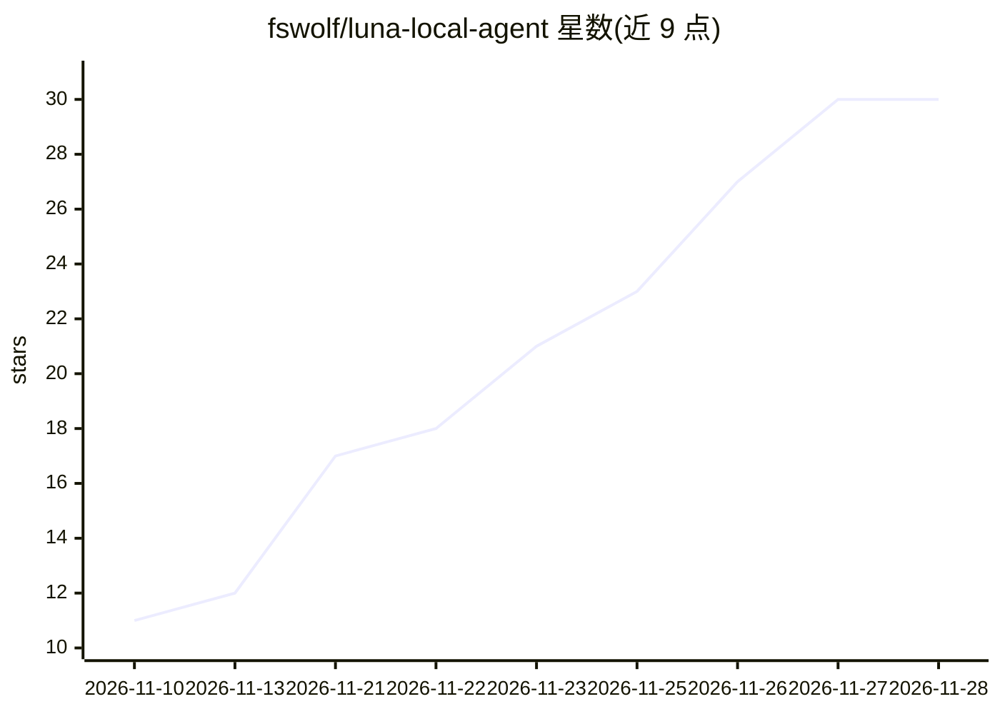

# fswolf/luna-local-agent

⭐ 30 · Python · AGPL-3.0 · 推送 2026-11-27 · [GitHub](https://github.com/fswolf/luna-local-agent) · [官网](https://github.com/fswolf/luna-local-agent/wiki) · 个人维护

**全本地私有 AI 语音伴侣：语音进出、记忆、工具与可视化推理**

在本地机器上运行的多模型协作 agent：一个聊天模型负责思考与对话，小模型分别处理语音识别（Faster-Whisper）、语音合成（Kokoro TTS）、视觉与记忆检索。持久化状态包含事实记忆、对话笔记、情绪与例程；工具覆盖文件、命令、邮件、网络研究、Home Assistant 智能家居与 MCP 服务器，敏感操作需用户批准。每轮交互留有推理记录与逐 token 置信度的实时视图。支持 Linux/macOS/Windows，通过 LM Studio 或 llama.cpp 加载本地模型，无需云 API。

## 筛选速览

| 维度 | 判定 | 备注 |
|---|---|---|
| AI 角色 | `ai-native` | 本体是模型或模型工具 |
| 许可风险 | `permissive` | AGPL-3.0 |
| 部署形态 | `None` |  |
| 模型依赖 | — | README 未给出锁定关系 |
| 硬件要求 | — | 无带数字的原话,不猜 |
| 安装摩擦 | `low` | 无编译、无系统依赖或容器化 |
| 成熟度 | — | 结构信号不足 |

## 能力要点

- 全本地运行，无云 API（Whisper 输入 + Kokoro TTS 输出）
- 多模型协作：聊天、视觉、语音、记忆、判断各由专门模型承担
- 每轮推理记录与逐 token 置信度实时可视化
- 多用户识别：按声纹/人脸区分成员并隔离各自记忆

## 适用场景

- 在个人电脑上搭建不联网的语音助手/伴侣
- 通过语音和工具控制家居设备（灯光、插座、温控）
- 查看 AI 每轮回答前的推理过程与置信度
- 多成员家庭中按人区分记忆与权限

## 场景标签

`语音 Agent` `AI 助手` · 领域:对话与助手

## 证据(README 行号)

> L12: **A persistent-state agent manager, with heavy tooling, research and
> L50: - LM Studio or llama.cpp: the local model. Any model with tool calling should work; the installer picks one for you
> L85: Everything runs locally. No cloud APIs required.

## 星数曲线

2026-11-10 11 → 2026-11-28 30（+19）

---
*卡片 v1 · prompt 1.4 · 生成 2026-11-18 · 置信度 high · 依据 README sha `964cf25a2d76` · [字段定义](../../DATASET.md)*
