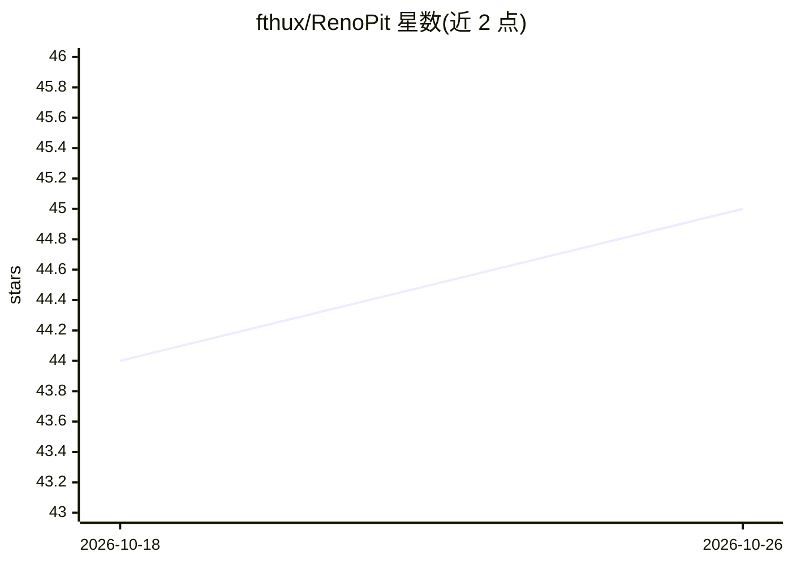

# fthux/RenoPit

⭐ 45 · Python · AGPL-3.0 · 推送 2026-10-21 · [GitHub](https://github.com/fthux/RenoPit) · [官网](https://renopit.fthux.com) · 个人维护 · 中文 README

**面向装修消费者的 AI 审查引擎：审查图纸/合同/报价找坑**

用户上传装修设计图（JPG/PNG/WEBP）与文档（合同/报价单 TXT/MD/DOCX/PDF）并补充文字说明，系统用多模态大模型识别图纸、匹配本地知识库坑位数据并联网搜索，生成在线可视化批判报告与可下载 PDF，内容涵盖卫生死角、过度装修、隐形陷阱、增项预测与跨文档交叉核查。项目自我定位为消费者辩护人而非中立审查工具。部署方式为 Docker Compose，需自备 OpenAI SDK 兼容的 LLM API Key（图片分析需多模态模型），提供在线 Demo。

## 筛选速览

| 维度 | 判定 | 备注 |
|---|---|---|
| AI 角色 | `ai-native` | 本体是模型或模型工具 |
| 许可风险 | `viral` | AGPL-3.0 |
| 部署形态 | `self-host` | docker 或自建部署 |
| 模型依赖 | — | README 未给出锁定关系 |
| 硬件要求 | — | 无带数字的原话,不猜 |
| 安装摩擦 | `low` | 无编译、无系统依赖或容器化 |
| 成熟度 | — | 结构信号不足 |

## 能力要点

- 多模态 AI 分析设计图 + 合同/报价单，输出结构化批判报告
- 本地知识库坑位匹配 + 联网搜索最新套路
- 增项预测与跨文档交叉核查
- 一键生成 PDF 报告，支持 Docker Compose 部署

## 适用场景

- 装修前上传设计图和合同报价，识别过度装修和隐形增项
- 生成批判性分析报告，与装修公司沟通时作为依据
- 不请第三方监理也能获得专业批判意见

## 场景标签

`多模态` · 领域:感知与多模态

## 证据(README 行号)

> L18: **装闭（RenoPit）** 是一款面向装修消费者的 AI 审查引擎。你只需上传房屋设计图（户型图、效果图等）和装修相关文档（合同、报价单等），系统便会利用多模态 AI 进行批判性分析——找出设计图中的卫生死角、揭露报价单中的过
> L63: 2. **AI 分析**：多模态大模型识别图纸 + 本地知识库匹配核心坑位 + 联网搜索最新套路，输出结构化批判报告

## 星数曲线

2026-10-18 44 → 2026-10-26 45（+1）

---
*卡片 v1 · prompt 1.4 · 生成 2026-10-25 · 置信度 high · 依据 README sha `9b1463b3bf5d` · [字段定义](../../DATASET.md)*
