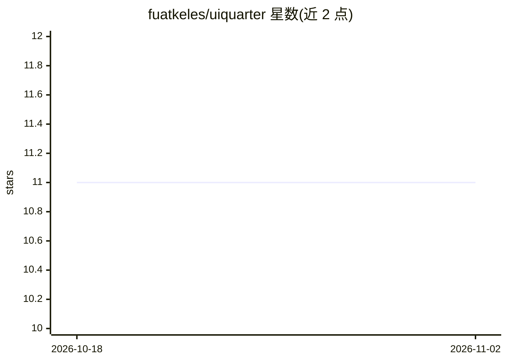

# fuatkeles/uiquarter

⭐ 11 · TypeScript · MIT · 推送 2026-02-24 · [GitHub](https://github.com/fuatkeles/uiquarter) · 个人维护

**为 AI 编码助手生成 UI 代码库上下文文件的静态分析 CLI**

面向前端/UI 代码库的静态分析命令行工具：通过 20 个分析器（核心、框架、后端、质量四类）解析组件模式、依赖图与架构洞察，覆盖 React、Vue、Svelte、Angular、Next.js 等 10 个框架；随后为 Claude Code、Cursor、Copilot、Aider 等 7 种 AI 编码助手生成优化上下文文件（如 CLAUDE.md、.cursorrules），并内置 MCP 服务器（stdio/HTTP）供 AI 工具实时查询组件详情与架构洞察。另提供 query、lint、drift、ci、HTML 报告等命令。以 npm 全局安装，需 Node.js >= 18。

## 筛选速览

| 维度 | 判定 | 备注 |
|---|---|---|
| AI 角色 | `ai-ecosystem` | LLM/agent 周边工具 |
| 许可风险 | `permissive` | MIT |
| 部署形态 | `library` | 以包/库形式分发 |
| 模型依赖 | — | README 未给出锁定关系 |
| 硬件要求 | — | 无带数字的原话,不猜 |
| 安装摩擦 | `low` | 无编译、无系统依赖或容器化 |
| 成熟度 | — | 结构信号不足 |

## 能力要点

- 20 个分析器覆盖 10 个前端框架与 Express/Prisma 等后端技术
- 一条命令生成 7 种 AI 编码助手的上下文文件
- 内置 MCP 服务器（stdio/HTTP），暴露 4 个查询工具
- CI 模式检测回归、drift 对比基线快照、lint 检查项目规范

## 适用场景

- 为 Claude Code/Cursor 等编码助手生成项目上下文，减少探索开销
- 在 CI 中检测架构回归并向 PR 发评论
- 查询组件依赖关系与生成 HTML 架构仪表盘

## 场景标签

`提示工程` · 领域:Agent 开发

## 证据(README 行号)

> L7:  Static analysis CLI that extracts component patterns, dependency graphs, and architectural insights from UI codebas
> L51: |**7** AI Targets|Claude, Codex, Cursor, Windsurf, Cline, Copilot, Aider|
> L170: **`uiquarter serve`** — Start an MCP (Model Context Protocol) server for real-time AI tool integration.

## 星数曲线

2026-10-18 11 → 2026-11-02 11（+0）

---
*卡片 v1 · prompt 1.4 · 生成 2026-11-02 · 置信度 high · 依据 README sha `ba6f53e0de76` · [字段定义](../../DATASET.md)*
