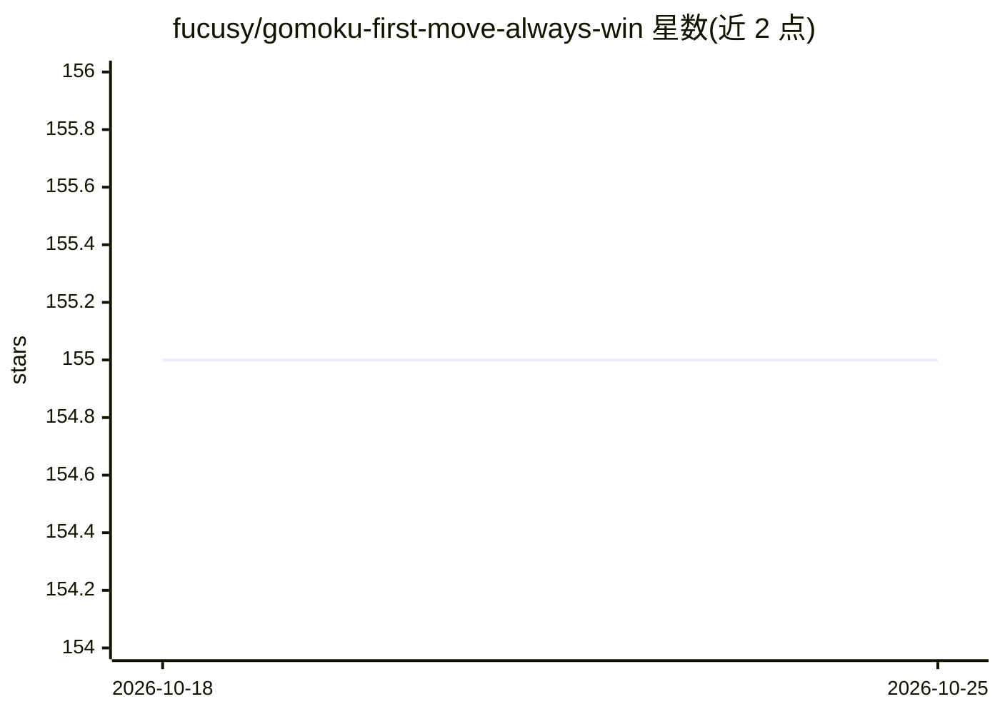

# fucusy/gomoku-first-move-always-win

⭐ 155 · MIT · 推送 2025-11-18 · [GitHub](https://github.com/fucusy/gomoku-first-move-always-win) · [官网](http://www.bytedance.ai/gomoku.html) · 个人维护 · 中文 README

**五子棋先手必胜 AI：证明数搜索求解先手获胜走法**

基于 Louis Victor Allis 1994 年证明数搜索（proof-number search）思路实现的五子棋 AI，用 C++ 与 Python 编写，通过 RocksDB 存储棋盘状态，提供 tornado Web 服务在浏览器对弈，并给出在线试玩地址。README 声明 AI 的限制：当白方走子距离任意已有棋子超过 3 步时可能失效。附带开发指南，演示如何编码棋盘、用引导走法求解并验证棋局。运行需自行编译（C++17），Linux/macOS 已测试。

## 筛选速览

| 维度 | 判定 | 备注 |
|---|---|---|
| AI 角色 | `ai-native` | 本体是模型或模型工具 |
| 许可风险 | `permissive` | MIT |
| 部署形态 | `library` | 以包/库形式分发 |
| 模型依赖 | — | README 未给出锁定关系 |
| 硬件要求 | — | 无带数字的原话,不猜 |
| 安装摩擦 | `medium` | 含编译或系统依赖之一 |
| 成熟度 | — | 结构信号不足 |

## 能力要点

- 证明数搜索（proof-number search）求解五子棋先手必胜策略
- RocksDB 存储棋盘状态，tornado 提供 Web 对弈界面
- 提供在线试玩地址与视频演示
- README 声明限制：白方远离已有棋子 3 步以上时 AI 可能失效

## 适用场景

- 在浏览器中与先手必胜 AI 对弈五子棋
- 本地编译运行并自行求解指定棋局
- 研究证明数搜索在棋类求解中的应用

## 场景标签

 · 领域:游戏 AI/博弈求解

## 证据(README 行号)

> L1: # Gomoku, first move always win AI
> L2: Inspired by https://github.com/davda54/pn-search: C++ implementation of proof-number and dependency-based search for
> L60: # AI limitation

## 星数曲线

2026-10-18 155 → 2026-10-25 155（+0）

---
*卡片 v1 · prompt 1.4 · 生成 2026-10-22 · 置信度 mid · 依据 README sha `90740411ad8f` · [字段定义](../../DATASET.md)*
